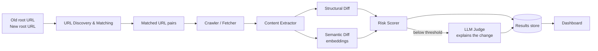

# MavDitto — Build Plan

2026-09-21 · @Someone

## Overview

When a page moves from Sitecore to WordPress (or from an old site to a new one), someone currently has to manually eyeball the old and new versions to check that content wasn't dropped, reworded in a way that lost meaning, or broken (missing images, dead links, broken heading structure). This is slow and error-prone at scale, and subtle content loss (a paragraph reworded so it reads fine but drops a stat or a policy detail) is easy to miss with a plain text-diff.

This project builds a pipeline that crawls paired old/new pages, compares them structurally and semantically, and produces a ranked, human-readable report of what changed — flagging likely content loss versus harmless rewording. Results are shown in a dashboard so a reviewer can scan risk at a glance instead of opening every page pair by hand.

## Goals & success criteria

- Given just the old subsite's root URL and the new subsite's root URL, automatically discover and pair up matching pages, then detect pages where content was likely lost or degraded during migration
- Catch issues a plain text-diff misses: reworded paragraphs that drop facts, missing images/alt text, broken heading structure, dropped or changed links
- Rank flagged pages by risk so a reviewer checks the worst offenders first instead of reading every page
- Produce a dashboard that's usable by someone who isn't the tool's author (a reviewer or manager), not just a CLI output
- No dependency on OIT-internal systems, credentials, or data access — runs entirely against publicly reachable pages (live sites + Wayback Machine snapshots where needed)
- Bonus: the URL Discovery & Matching step's output (`url_pairs.csv`) is a standalone useful artifact — a full old→new URL mapping, independent of the validation results. Useful on its own for setting up redirect rules or just auditing what mapped to what.

**MVP definition of done**: given 10–20 real or Wayback-sourced page pairs, the pipeline produces a dashboard ranking them by risk, with structural + semantic similarity scores and at least a few pages correctly flagged as "content missing" or "clean."

## Architecture



1. **URL Discovery & Matching** — given the old subsite's root URL and the new subsite's root URL, crawl both (via `sitemap.xml` when available, else a same-domain recursive crawl) to enumerate every page under each. Pair old pages to new pages by matching URL path/slug similarity, falling back to page-title similarity when paths differ. Produces the URL pairs list automatically — no manual CSV needed. Also flags old pages with no matching new page (possibly not migrated) and new pages with no old match (net-new content).
2. **Crawler/Fetcher** — for each matched pair, fetches rendered HTML for both old and new pages. The old page may come from the live subsite, a static export, or a Wayback Machine snapshot if the old subsite is already gone.
3. **Content Extractor** — strips nav/footer/ads/boilerplate, keeps headings, body text, images (with alt text), and links. Outputs a normalized structure for each page.
4. **Structural Diff** — compares heading hierarchy, image count + alt-text presence, link count/targets between old and new. Cheap, deterministic, catches obvious breakage.
5. **Semantic Diff** — embeds old and new body text (chunked by section) and computes similarity. Catches meaning loss that survives a rewording, which structural diff can't.
6. **Risk Scorer** — combines structural + semantic signals into a single risk score/tier per page (e.g. Clean / Minor rewording / Major rewording / Missing content).
7. **LLM Judge** (only for pages below a similarity threshold, to control cost) — given the old and new text, produces a short natural-language explanation of what specifically changed (dropped a section, changed a number, removed a CTA).
8. **Results store** — persists per-page scores, diffs, and LLM explanations so the dashboard doesn't need to recompute anything.
9. **Dashboard** — reads the results store and displays pages ranked by risk with drill-down detail per page (see Dashboard requirements).

## Tech stack

| Layer | Recommendation | Why |
| --- | --- | --- |
| Language | Python | Best library support for crawling, embeddings, and data wrangling |
| Fetching | `httpx` + `playwright` (for JS-rendered pages) | Sitecore/WordPress pages may need JS rendering; Playwright handles both static and dynamic pages |
| Content extraction | `trafilatura` or `readability-lxml` | Purpose-built for stripping boilerplate and extracting main content |
| Old-page snapshots | Wayback Machine API (`waybackpy` or raw CDX API) | Free way to get pre-migration page content with no OIT access needed |
| Embeddings | `sentence-transformers` (e.g. `all-MiniLM-L6-v2`, local) or OpenAI/Anthropic embeddings API | Local model = free and no data leaves your machine; API = higher quality, small cost |
| Similarity | cosine similarity via `numpy`/`scikit-learn` | Standard, simple, well understood |
| LLM judge | Claude API (or any LLM API) | Only called for flagged pages, keeping cost low |
| Results store | SQLite (or just JSON files for MVP) | No infra to stand up, easy to query for the dashboard |
| Dashboard | Streamlit, or a small React/Next.js app | Streamlit = fastest to build and still looks polished; React/Next.js = more control and better if this becomes a portfolio centerpiece |
| Orchestration | A single Python script/CLI to start; consider `prefect` or plain functions only if it grows | Don't over-engineer the MVP |

**Recommendation for Claude Code**: start with Streamlit for the dashboard to get something working end-to-end fast; a polished React dashboard can be a v2 if there's time/interest.

## Data / test set

All you need to provide is two root URLs: the old subsite and the new subsite. The URL Discovery & Matching step handles enumerating and pairing pages under each — no manual URL-pair list to maintain.

1. **Both subsites still live** — simplest case: crawl both roots directly.
2. **Old subsite already retired** — use the Wayback Machine's CDX API against the old root URL to enumerate archived pages under that path, then match those to the new subsite the same way.
3. **Synthetic worst-case pairs** (for validating the scorer, not the demo) — take a couple of real pages, deliberately drop a paragraph, reword a section, or remove an image, and confirm the pipeline flags them correctly.

**MVP target**: 10–20 page pairs total, mixing Wayback-sourced real pairs with a couple of synthetic worst-case pairs to prove the scorer works.

## Build phases

| Phase | Scope | Deliverable |
| --- | --- | --- |
| 1. Fetch + extract | Fetcher + content extractor working on 5 test pages (live + Wayback) | Script that outputs clean text/headings/images/links for a URL |
| 2. Structural diff | Heading/image/link comparison between page pairs | CLI output showing structural differences per pair |
| 3. Semantic diff | Embed + cosine similarity on body text | Similarity score per pair, validated against a known-bad synthetic pair |
| 4. Risk scoring | Combine structural + semantic signals into a single tier | Ranked list of pages by risk |
| 5. Dashboard v1 | Streamlit app reading from the results store, table view sorted by risk | Working dashboard on the full 10–20 page test set |
| 6. LLM judge | Add natural-language change explanations for flagged pages | Dashboard shows "what changed" text per flagged page |
| 7. Dashboard v2 (optional) | Polish: page detail view, charts, filtering, maybe React rebuild | Portfolio-ready polish pass |

Phases 1–5 are the MVP ("it works end to end"). Phase 6 is the "impressive" layer. Phase 7 is optional polish once the core is proven.

## Dashboard requirements

**Main view — risk-ranked table**

- One row per page pair: old URL, new URL, risk tier (Clean / Minor / Major / Missing), similarity score, last-checked date
- Sortable/filterable by risk tier
- Color-coded risk (e.g. green/yellow/red) so a reviewer can scan instantly

**Detail view — per page**

- Side-by-side (or stacked) old vs new content
- Structural diff summary: heading count, image count + missing alt text, link count/targets
- Semantic similarity score with a plain-language interpretation ("85% similar — likely just rewording")
- LLM judge explanation of what changed, for flagged pages
- Link out to both the old (Wayback) and new (live) URLs

**Summary header**

- Total pages checked, count per risk tier, overall "health" of the migration batch

**Nice-to-have (post-MVP)**

- Trend view if pages get re-checked over time
- Export flagged pages as a CSV/report for handoff to a content reviewer
- "Fix it" checklist export — turn flagged pages into a shareable checklist (CSV or generated doc) a content editor can work through and check off
- Diff view with word-level highlighting (added/removed/changed) instead of just a similarity score, for faster human scanning
- Confidence explanation on the "Clean" tier — show why a page is clean (high similarity + no structural changes) so reviewers trust the automation

## Suggested repo structure

```
mavditto/
├─ data/
│  ├─ url_pairs.csv          # old_url, new_url, source (live | wayback)
│  └─ results.db             # SQLite results store (or results/*.json)
├─ src/
│  ├─ fetch.py               # crawler / fetcher (httpx + playwright)
│  ├─ extract.py             # content extraction (trafilatura)
│  ├─ diff_structural.py     # heading/image/link comparison
│  ├─ diff_semantic.py       # embeddings + cosine similarity
│  ├─ score.py               # combines signals into a risk tier
│  ├─ llm_judge.py           # Claude API call for flagged pages
│  └─ pipeline.py            # orchestrates the above end to end
├─ dashboard/
│  └─ app.py                 # Streamlit app reading from data/results.db
├─ tests/
│  └─ test_pipeline.py       # unit tests, incl. the synthetic worst-case pair
├─ requirements.txt
└─ README.md
```

**Suggested order for Claude Code to build in**: discover.py → `fetch.py` → `extract.py` → `diff_structural.py` → `diff_semantic.py` → `score.py` → `pipeline.py` (wires it together, run on the test set) → `dashboard/app.py` → `llm_judge.py` last, since it's the most expensive/optional layer.

## Open questions / risks

- **Rate limiting / robots.txt**: check UTA's sites and the Wayback Machine don't block or rate-limit repeated fetches; add delays/backoff if needed.
- **JS-heavy pages**: if Sitecore/WordPress pages render content client-side, static fetching may miss content — Playwright should cover this, but worth confirming early on a real page.
- **Embedding model choice**: local (`sentence-transformers`) is free but slightly lower quality; an API-based embedding model costs a little but may separate "minor rewording" from "real content loss" more reliably. Worth trying both on the synthetic worst-case pair to see if it matters.
- **LLM judge cost**: kept low by only calling it on pages below the similarity threshold, but worth setting an explicit budget/cap while testing.
- **False positives**: legitimate rewording (tone/style updates) shouldn't get flagged as "content missing" — the risk scorer's thresholds will need some manual tuning against the test set.

## Additional features (post-MVP)

**Redirect map generator**

- Since the URL Discovery & Matching step already produces the old→new pairing, this is a natural add-on: generate a ready-to-deploy redirect rules file (`.htaccess` or `web.config`, depending on the new site's server) straight from `url_pairs.csv`
- Gives OIT a second concrete deliverable beyond the QA report — something that can actually be dropped into a server config
- Should flag old pages with no matched new page separately, since those need a manual decision (redirect to a parent page? leave as a 404?) rather than an automatic rule

**PDF / document link checker**

- University pages frequently link out to PDFs (forms, syllabi, policies) — these are easy to miss in a migration since they're not part of the page's own content, just links to files
- Extend the link-checking already happening in Structural Diff: for every PDF/doc link found on the old page, check whether an equivalent link exists and resolves (not a 404) on the new page
- Flag: PDFs that didn't get migrated at all, PDFs that moved but the link wasn't updated, and PDFs that now 404 on either side
