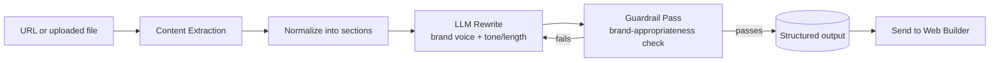
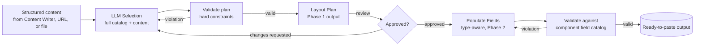
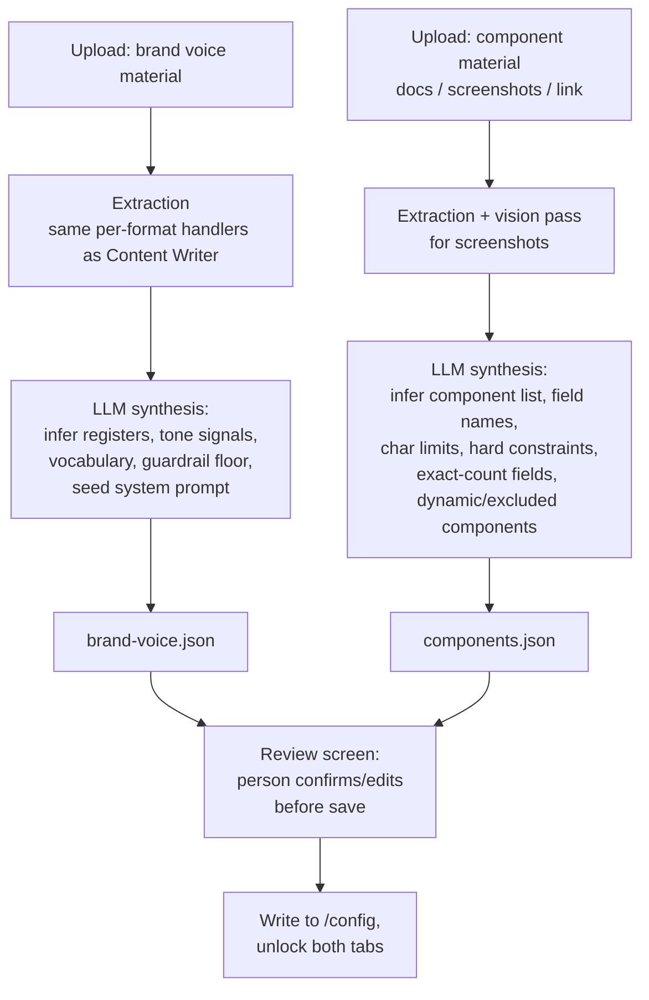

# MavDitto — Content Writer & Web Builder: Plan & Design Guide

Sep 24, 2026 · @Ashzaeen

## Overview & goals

Two new LLM-powered tabs, designed as one pipeline rather than two disconnected tools:

**Content Writer** — given a link to an old page, or an uploaded file (PDF, Word, PPT, Markdown, Excel, or an image), rewrites the content in UTA's voice. Solves a real, recurring pain point: a client hands over a PPT or PDF and it needs to become clean, web-ready copy, in UTA's voice, not a copy-paste of slide bullet points.

**Web Builder** — picks up where Content Writer leaves off. Given the same kind of input (a URL, or an uploaded file), it decides how to lay that content out using UTA's actual Sitecore component library, so the output isn't just text but a concrete, buildable page.

**Why one pipeline**: Content Writer produces clean, sectioned copy; Web Builder maps that copy onto real components. A "Send to Web Builder" handoff lets someone run both in sequence, but each also works standalone — someone who already has good copy can skip straight to Web Builder, and someone who just needs better writing doesn't have to touch layout at all.

**Shared goal for both**: whatever tone or length is chosen, the output must stay recognizably, appropriately UTA — never generic AI copy that happens to be about UTA.

## Brand voice profile (seed version)

A quick first-pass sample (UTA's Mission page, an Admissions "Apply" page, and a few instructional/FAQ pages) already shows UTA doesn't have one voice — it has (at least) two distinct registers depending on audience. This seed profile is enough to build against; the full version (Quick first pass → full crawl-based version, per earlier discussion) should broaden the sample size once the crawler exists.

**Register 1 — Institutional** (mission/about/policy pages): formal, third-person, no contractions, values-forward nouns ("collaboration," "excellence," "innovation," "integrity"). Sentences run longer and more compound. Example: *"The University is committed to providing access and ensuring student success, and to a culture of innovation, entrepreneurship, and commercialization of discoveries by our community of scholars."*

**Register 2 — Prospective-student / service** (admissions, how-to, FAQ pages): warm, second-person ("you," "you're"), plain and direct, occasional exclamation for encouragement, step-by-step instructional structure. Example: *"Applying for admission is easy at UTA and we're here to support you every step of the way!"*

**Consistent across both registers**: plain vocabulary, minimal jargon, short-to-medium sentences, specific facts cited with sources rather than vague superlatives (e.g. citing U.S. News & World Report rather than saying "top-ranked").

**Seed system prompt guidance for Content Writer**:

- Detect or ask which register the target page calls for (institutional vs. prospective-student/service) and write in that register by default
- Never let a requested tone (more casual, more formal, punchier) override UTA's baseline: no slang, no overclaiming, no unsourced superlatives, always plausible as something UTA's own Marketing, Messaging, and Engagement office would publish
- Prefer concrete facts and sourced figures over generic marketing language
- Second person is the default for anything audience-facing (admissions, current students, prospective students); third person for institutional/policy content

**Tone options exposed to the user**: a small set (e.g. Warmer / More formal / More concise / More detailed) that adjust within-register, not across the UTA-appropriateness floor — the tone selector changes style, never changes whether the output sounds like UTA.

## Content Writer: inputs & modes

**Input options**

- A URL to an old page (crawled and extracted, reusing MavDitto's existing fetch/extract infrastructure)
- An uploaded file: PDF, Word (.docx), PowerPoint (.pptx), Markdown (.md), Excel (.xlsx), or an image (for image-based content like a flyer or a screenshot of text)

**Tone options** (see Brand voice profile for the floor these sit above): Warmer, More formal, More concise, More detailed — selectable independently, not mutually exclusive

**Length options**: Match original length, Condense (shorter web-ready summary), Expand (fill out thin source material, e.g. a sparse PPT slide) — useful specifically for the PPT/PDF pain point, where slide bullet points are often too terse to read as web copy as-is

**Output register**: auto-detected from context (see Brand voice profile), with a manual override if the tool guesses wrong (e.g. a page that reads as prospective-student-facing but is actually meant for current students)

## Content Writer: architecture & pipeline



1. **Content Extraction** — pulls text (and notes images/media present) from the source: for a URL, reuses MavDitto's fetch/extract; for files, uses format-specific extraction (PDF text extraction, python-docx for Word, python-pptx for PowerPoint — pulling slide titles and bullet text separately, openpyxl for Excel, a vision-capable model pass for images).
2. **Normalize into sections** — converts whatever structure the source had (slides, cells, paragraphs) into a common intermediate format: a title, an ordered list of sections each with its own heading and body text, and a list of any images/media referenced. This is what makes PPT-to-web-copy actually work: slide-by-slide bullets become web-appropriate sections, not a bullet dump.
3. **LLM Rewrite** — the extracted/normalized content plus the brand voice system prompt plus the chosen tone/length options go to the LLM, which produces rewritten copy per section.
4. **Guardrail Pass** — a second LLM call (or a rules-based check) verifies the rewrite against the brand-appropriateness floor from the Brand voice profile (no slang, no unsourced superlatives, register consistency) independent of whatever tone was requested. Anything that fails goes back through the Rewrite step with the specific issue flagged.
5. **Structured output** — persists the final sectioned copy, ready either to display for review/editing or to hand off to Web Builder.

## Content Writer: output format

Structured, not a single text blob — this is what lets Web Builder map pieces onto specific components rather than guessing where to split a wall of text:

```json
{
  "page_title": "string",
  "register": "institutional | prospective-student",
  "sections": [
    {
      "heading": "string | null",
      "body": "string",
      "kind": "intro | body | cta | fact-list | quote | faq-item",
      "links": [{"text": "string", "url": "string"}],
      "media_refs": ["description of image/media originally present, if any"]
    }
  ]
}
```

`kind` is a lightweight hint (not a hard classification) that Web Builder uses as a starting signal for component matching — e.g. a `fact-list` section hints at Datapoint Listing, a `cta` section hints at one of the CTA components. Every section keeps its own heading/body/links so Web Builder can place them independently rather than needing to re-split a single merged output.

## Web Builder: inputs & two-phase output

**Input options** (same shape as Content Writer, so either tool can be an entry point): a URL to an old page (typically Cascade or WordPress), an uploaded file (PDF, Word, PPT, Markdown, Excel, Images), or — the common case — Content Writer's structured output handed off directly.

**Phase 1: Layout plan** — given the content, propose which UTA components to use, in what order, and why. No fields populated yet. Output looks like:

| Order | Component | Maps to | Rationale |
| --- | --- | --- | --- |
| 1 | Hero Landing | Page title + intro section | Primary hero, supports title/subheading/body/link — fits the intro |
| 2 | Datapoint Listing | The 3 stats in section 2 | Section reads as a fact-list; component is built for exactly this |
| 3 | Accordion | The FAQ section | Rich text, unlimited length, ideal for FAQ-style content |

The person reviews this plan — approves it, or asks for changes (swap a component, reorder, drop a section) — before anything gets populated.

**Phase 2: Populated fields** — once the plan is approved, Web Builder fills in each chosen component's actual fields (see Component field catalog), respecting every hard constraint (character limits, exact image/link counts) from the catalog. Output is ready to paste directly into Sitecore, field by field, component by component.

## Web Builder: LLM-driven mapping & validation

**Selection is one reasoning call, not a rule-based filter.** An earlier draft of this tool used a hand-coded priority list (a `kind` hint, then media availability, then length vs. character limits) to pick a component for each section. That doesn't hold up against 62 real components with genuinely different purposes — a deterministic filter can't reason about *why* one component fits a section's actual intent better than another that happens to pass the same surface checks. So selection is a single LLM call: the model is given (1) the full component catalog — every one of the 62 entries, each with its purpose, its fields, and its constraints (see the catalog schema below) — and (2) the structured content sections needing a home. It reasons about intent, not just shape, and returns a full Layout Plan: the same Order/Component/Maps to/Rationale table already defined in Phase 1, arrived at by matching each section's actual communicative purpose against each candidate component's actual purpose, not by scoring signals.

**Concretely, what changes:** instead of "this section has 2 images and under 100 characters, so it must be a Four Image Grid or a Hero," the model sees the full text of what Four Image Grid, Hero Landing, Datapoint Listing, Circle Top Profile Card, and every other candidate are actually *for*, weighs which one the content is trying to accomplish, and picks that one — with the rationale column in the Layout Plan stating why in plain language a human reviewer can sanity-check.

**Hard constraints move from filter to validator.** The absolute rules — Four Image Grid needs exactly 4 images, a character cap is a cap not a suggestion, certain Hero variants have no field of their own and must write to page-level Title/Description instead, dynamic components are never a manual-copy target — don't disappear. They become a validation pass that runs after the LLM proposes a plan, and again after it populates fields. A violation isn't silently absorbed; it's named specifically and sent back to the same LLM call to fix — the identical guardrail-loop pattern already used in Content Writer's Guardrail Pass.

Example: the LLM proposes Four Image Grid for a section that only has two images available. The validator doesn't accept "close enough" — it returns "Four Image Grid requires exactly 4 images; this section provides 2," and the LLM either finds more images elsewhere in the source material, flags it for the reviewer to supply, or picks a different component built for fewer images.

**Field population is type-aware, not one-size-fits-all text.** Once the plan is approved, populating each component's fields is also model-driven, but the job differs by what kind of field is being filled:

- **Rich text fields** — output isn't plain text, it's formatted using whatever tools Sitecore's rich text editor actually exposes (bold/italic, headings, bulleted and numbered lists, hyperlinks — the exact supported set to be locked once the toolbar screenshot is in hand). The field arrives already structured, so a publisher pastes it and it lands formatted, rather than having to manually re-apply formatting to a wall of plain text.
- **CTA / button fields** — never a single blob. These come back as distinct, separately-copyable pieces: the link URL, the button label text, and — where the component supports a color choice — a suggested color plus a one-line rationale, constrained to whichever colors are actually valid for that specific component (e.g. UTA Blue for a standard action; Orange only where that component's accessibility rules allow it — never a color the catalog doesn't list as valid for that field).
- **Image fields** — a role/crop note (what kind of image belongs here and why), plus a flagged handoff to the Alt Text tool elsewhere in MavDitto for that image's alt text — not Web Builder re-inventing that job.
- **Enum-style fields** (anything the catalog defines as "must be one of these exact values") — the model is constrained to one of the allowed values, never an invented one.
- **Plain text fields** — populated as before, respecting character limits.

**Phase 2's output reflects this.** Instead of one flat "Field: value" list, each component renders as its own card with fields shown as their actual type — a rich text field previewed with its formatting visible, a CTA field shown as its URL/label/color trio, an image field shown as its role note plus the alt-text handoff flag — not a return to a plain text dump.

## Web Builder: presenting results after the LLM pass

Populated Fields isn't a form to fill and forget — it's the surface the publisher spends the most time in, since it's where they read the model's decisions, judge whether to trust each one, and physically paste everything into Sitecore, one component at a time. It needs to answer three things at a glance: *what did it build, do I trust each piece, and where am I in getting it all pasted in.*

**Skeleton loading while the pass runs.** The LLM selection and population calls aren't instant, and a bare spinner over a blank screen makes the wait feel longer and hides what's coming. Instead, as soon as the approved Layout Plan is known, Phase 2 renders one empty, component-shaped skeleton card per plan row immediately — right component name and order, fields still loading — and each card fills in with real content and its status badge as its own population call finishes, rather than the whole page waiting on the slowest one.

**1. A design-page link per component, not a rendered preview.** Rendering an accurate visual mock of each UTA component — real layout, colors, typography — is real design and engineering work Web Builder doesn't need to take on. Instead, every card links out to that component's own page on UTA's design system, so the publisher can see exactly what it looks like on a live site in one click, without Web Builder reproducing it. The "preview" of the page's shape is the ordered stack of cards itself (component name, order, and status all visible at a glance) plus these links — not a rendered mock.

**2. Per-component cards, each with a status.** Below the preview, one card per component, in plan order. Each card carries a status badge:

- **Valid** — passed the validator on the first pass.
- **Adjusted** — the validator caught something and sent it back to the model at least once; the card shows what was flagged and how it was corrected, so the publisher isn't blind to a correction having happened (trust matters more, not less, when something needed fixing).
- **Needs review** — the model couldn't fully resolve a constraint on its own (e.g. a Four Image Grid where the content only ever had 2 images and no more could be found) and is flagging it for a human decision rather than guessing.

**3. Field-level rendering by type.** Rich text shown formatted, with both "Copy formatted" and "Copy plain" actions; CTA/button fields shown as their link + label + color trio, each independently copyable; image fields shown as a role/crop note plus a flag pointing to the Alt Text tool; enum fields shown as the chosen allowed value; plain text fields shown with their character count (e.g. "Title: 42/100").

**4. Every field is editable in place.** The model's output is a strong first draft, not gospel — especially before the catalog is fully populated with real UTA data. Any field in any card can be hand-edited directly before copying; an edited field gets a small "edited" tag so it's visually distinct from what the model produced, and the copy action always copies the current (possibly edited) value.

**5. A paste-progress tracker, not a one-shot copy.** A typical page has somewhere between 5 and 10 components — a publisher works through them one at a time in Sitecore, and losing track of which ones are already pasted in is a real failure mode for a plain list. Each card gets a "Mark as pasted" toggle; a progress indicator at the top of Phase 2 ("6 of 9 components pasted") tracks overall completion. This state persists for the session, surviving a refresh, so stepping away doesn't lose progress — it's local UI state, not anything written back to Sitecore, consistent with Web Builder never pushing content itself.

**6. Regenerate, scoped to what actually needs it.** Two actions, at different scopes: a per-card "Regenerate this component" (re-runs field population for just that one, keeping every other card and any manual edits elsewhere untouched) and a page-level "Regenerate all" as an escape hatch. Regenerating a single card re-validates just that card, not the whole page.

**7. Undo for edits and regenerates.** A manual edit and a "regenerate this component" are both destructive — either can overwrite something that was actually fine. A simple per-card undo stack (Figma/Notion-style) keeps the last few states of each card, so an accidental regenerate or a bad manual edit isn't a dead end; the publisher steps back to the prior version instead of having to redo it from scratch.

## Web Builder: architecture & pipeline



1. **LLM Selection** — a single call given the full component catalog (all 62 entries, each with purpose + fields + constraints) and every content section; the model reasons about each section's actual intent against each component's actual purpose and proposes assignments, rather than scoring surface signals like length or media count.
2. **Validate plan** — a deterministic check runs immediately on the proposed assignments (exact-count fields, dynamic components excluded from manual copy, shared-copy Hero variants) before the plan is ever shown to a reviewer. Violations go back to LLM Selection with the specific problem named.
3. **Layout Plan** — formats the validated matches into the reviewable table (see Phase 1 above) with rationale per row.
4. **Approval loop** — the person reviews, and any requested change (swap, reorder, drop) re-runs LLM Selection with that constraint locked in, rather than regenerating the whole plan from scratch.
5. **Populate Fields** — once approved, generates each component's actual field content, type-aware: rich text formatted to Sitecore's toolbar, CTA fields as link + label + color, image fields as a role note plus an Alt Text tool handoff, enum fields constrained to allowed values, plain text trimmed to limits.
6. **Validate against the catalog** — a deterministic check confirms every populated field respects its component's real constraints — character counts, exact image/link counts, valid color options, allowed enum values. Anything that fails goes back to Populate Fields with the specific violation.
7. **Ready-to-paste output** — organized component-by-component, field-by-field, in the order from the approved plan.

## Dashboard tab designs

Both are new tabs in the left icon rail (per the Acrobat-inspired rehaul), each with their own icon and tile — equal billing with Migration Validator, Alt Text Generator, and Broken Link Inspector.

### Content Writer tab

**Setup panel**

- Input toggle: URL / Upload file
- Tone options (multi-select chips): Warmer, More formal, More concise, More detailed
- Length option (single-select): Match original, Condense, Expand
- Register override (optional dropdown): Auto-detect, Institutional, Prospective-student
- "Rewrite" button

**Results view**

- Section-by-section display: original content (collapsed by default) next to rewritten content
- Per-section regenerate button, for when one section needs another pass without redoing the whole page
- "Send to Web Builder" button, prominent, once results are ready
- Export as plain text/Markdown, for anyone who just wants the copy

### Web Builder tab

**Setup panel**

- Input toggle: URL / Upload file / Use Content Writer output (auto-selected when arriving via handoff)

**Phase 1 view — Layout Plan**

- The plan table (Order / Component / Maps to / Rationale) from the architecture above
- Per-row controls: a drag handle for actual drag-to-reorder (not up/down buttons — picking a row up and dropping it elsewhere in the list); remove row; swap component opens a visual component picker — a browsable panel of valid alternatives (filtered by the same hard constraints), each shown with its purpose blurb and a link to its design-system page, so swapping is recognition rather than reading a dropdown of names
- "Approve & Populate Fields" button

**Phase 2 view — Populated Fields**

- Full design in "Web Builder: presenting results after the LLM pass" above — the design-page links per component, per-component status cards (Valid / Adjusted / Needs review), in-place field editing, the paste-progress tracker, and the two regenerate actions all live in this tab
- Flag icon on any component using page-level fields (Hero Compact, Image Full, etc.) noting that those fields live on the parent page, not the component itself

## Component field catalog

The authoritative reference Web Builder's matcher and populator both read from. Pulled from UTA's live Digital Design System component pages.

### Catalog schema

Every one of the 62 components needs more than a name and a character limit to be mapped or populated correctly. Each entry needs:

- **id / name** — the component's exact name as it appears in Sitecore.
- **category** — Hero / CTA / Content block / Card / Dynamic, for organizing the catalog (not used for matching — the LLM selection call reasons over the full set, not by category).
- **purpose** — a plain-language description of when and why this component gets used, written specifically enough that an LLM (or a human) can tell it apart from a superficially similar one. Not "a text block" — the actual editorial job it does, and what it's *not* for.
- **fields\[\]** — every field the component exposes, each with:
  - **name** — the field's label as it appears in Sitecore's editor.
  - **fieldType** — one of `richtext`, `plaintext`, `link`, `button` (a link + label + optional color together), `image`, `enum` (with its `allowedValues` listed), `date`.
  - **constraints** — character limit, exact count (e.g. "exactly 4"), or whichever hard rule applies; `none` where there isn't one.
  - **notes** — anything a populator needs that doesn't fit the above (e.g. "inherits from page-level Title, not its own field").
- **examples** — one or two real, concrete pieces of content that fit this component well, anchoring the model's sense of "this is the kind of thing that goes here" beyond the abstract purpose description.

Two fully worked entries, at the level of detail every one of the 62 needs:

**CTA Accent**

- *category:* CTA
- *purpose:* A single, high-emphasis call to action meant to interrupt the page and push toward one specific next step. Used when there's one dominant action every reader on the page should consider — "Apply Now," "Request Information," "Schedule a Visit" — not a list of several possible actions (that's Link List) and not a secondary/supporting action (that's a Right Rail variant).
- *fields:*
  - Title — plaintext, 60 char limit; short, verb-led, matches the button label's intent
  - Body — plaintext, 198 char limit; one sentence of context, no additional CTAs
  - Button — button (link + label + color); label ≤ 24 chars; color: UTA Blue or UTA Web Blue only — never Orange as a solid button background, per accessibility rules
- *examples:* "Apply to UTA" with a body sentence about the application window and deadline; "Request more information" on a program landing page.

**Four Image Grid**

- *category:* Content block
- *purpose:* A visual showcase of exactly four related images with short captions — "four ways to get involved," a set of four facilities, four featured student stories. Never for fewer or more than four, and never a stand-in for a single hero image.
- *fields:*
  - Image 1–4 — image, exact count: 4 (all four required); each needs its own alt text via the Alt Text tool
  - Caption 1–4 — plaintext, 40 char limit each
- *examples:* four campus buildings each captioned with its name; four student organizations each captioned with name and one-line focus.

The full 62-entry catalog, filled in to this schema, is the next step once the internal export is in hand — the tables below are the \~35-component pass built from the public design-system page, and are a placeholder until the complete set is ingested to this shape.

### Hero components

| Component | Purpose | Fields & limits | Notes |
| --- | --- | --- | --- |
| Gradient Hero | The most basic hero — plain gradient background, no image. Use when a page needs a title/description hero but doesn't have (or need) a hero photo. | Title 100, Body 280 (from page Title/Description) | No component-level copy field — pulls from the parent page |
| Hero Compact | The shortest hero that still shows an image unobstructed. Use where hero space should stay minimal but a photo is still wanted. | Title 100, Body 280 (from page Title/Description) | Selected via "Hero Full or Compact" component; no link |
| Hero Image Full | The most-used hero site-wide — full-height image with title and description. Default choice for a standard page hero with a strong photo. | Title 100, Body 280 (from page Title/Description) | Most-used hero site-wide; also via "Hero Full or Compact" |
| Hero Video Full | The only approved way to put video in a hero. Use only when the source content specifically calls for a video hero, not a photo. | Title 100, Body 280 (from page Title/Description) | Vimeo Pro progressive link only; no audio-dependent videos; requires fallback image |
| Hero with Link | Hero Compact plus one link, styled as an orange CTA button. Use when the hero itself needs to drive one specific click. | Title 100, Body 280, Link 50 | One link, styled as an orange CTA button |
| Hero Landing | Primary hero for landing pages — adds an eyebrow/subheading beyond title and body. Use for program or initiative landing pages, not general content pages. | Title 100, Subheading 100, Body 280, Links 50 | Primary landing-page hero; eyebrow text + photo |
| Hero Landing with Links | Hero Landing plus up to three links. Use when a landing page's hero should surface several next steps at once, not just one. | Title 100, Body 280, Links 50 (up to 3) | 'New Look' only — don't mix with classic components |
| Hero with Slate | Embeds a Slate form directly into the hero. Use only when the page's primary action is filling out a form (event RSVP, request form), and a Slate Form ID is available. | Hero Title 100, Hero Description 280, Slate Form Title 100, Slate Form Description 150 | Requires a Slate Form ID |
| Quick Facts Hero | Title, description, a CTA, and up to four scannable stats. Use for program/event pages where a handful of headline numbers (enrollment, ranking, job placement rate) are the hero's main draw. | Title 100 (from page Title), Body 280, Quick Fact 200 (up to 4) | Good fit for program/event pages needing scannable stats |

### CTA components

| Component | Purpose | Fields & limits | Notes |
| --- | --- | --- | --- |
| CTA Accent | A short, high-emphasis callout that catches the reader's eye — single-line-announcement style, with room for up to 2 supporting links. Use for a short important notice, not a full call to action. | Title 100, Body 198, Links 50 (up to 2) | Single-line-announcement use case |
| CTA Billboard | A large callout for an upcoming event or a key offering — the only CTA variant with a secondary "PS" line. Use when one offering should dominate a section of the page. | Title 100, Body 298, Links 50, Secondary Text 198 | Only component with a "PS" line; 1 link |
| CTA Link List | A tidy way to present a bundle of links (2 main + up to 5 more) in the main body. Use when the content is fundamentally a set of destinations to choose from, not a single action. | Title/Description/Tagline unlimited, Buttons 50, Links 50 | 2 main links + up to 5 more (7 total) |
| CTA Rich Text | A simple standard CTA with up to 2 links for the main body — despite the name, it doesn't actually support rich text formatting. Use for straightforward body CTAs where CTA Accent's callout style isn't needed. | Title/Description unlimited, Buttons 50 | Despite the name, no actual rich text; up to 2 links |
| CTA Right Rail | A simple CTA for the sidebar, works in either rail. Use as the default right-rail CTA when no rich text or image is needed. | Title/Description unlimited, Link 50 | Works in left or right rail |
| CTA Right Rail Accent | Same as CTA Right Rail, styled with a blue accent. Use to visually differentiate one right-rail CTA from others on the same page. | Title/Description unlimited, Link 50 | Same as Right Rail, blue accent styling |
| CTA Right Rail Accent Rich Text | CTA Right Rail Accent with a rich text description (copy must be wrapped in \<p> tags). Use when the right-rail CTA needs formatted text, not just a plain description. | Title/Description unlimited, Link 50 | Adds rich text; copy must be wrapped in `<p>` tags |
| CTA Right Rail Detail | CTA Right Rail with a rich text description. Use when a right-rail CTA needs more than plain text but doesn't need the accent styling. | Title/Description unlimited, Link 50 | Same as Right Rail, adds rich text in description |
| CTA Right Rail Image | The title itself is the click target, not a separate button, and there are no links. Use when an image plus a title-as-link is enough. | Title 100, Description 200, no links | Title becomes the click target, not a separate button |
| CTA Right Rail Listing | Built for listing upcoming events, meetings, or seminars, with date/venue fields per child item (about 5 recommended). Use for a right-rail schedule, not a single CTA. | Parent Title 100/Link 50; child Title/Date/Venue unlimited | Built for events/meetings/seminars; \~5 recommended |
| CTA Right Rail Quick Links | A short list of up to 5 links for the sidebar. Use for a quick-links block, not a single call to action. | Title 100, Link 50 | Up to 5 links |
| CTA with Links | Requires exactly 4 images, paired with 3+ recommended links. Use for a link-heavy CTA block anchored by imagery, not a single-action CTA. | Title/Description unlimited, Links 50 | **Exactly 4 images required**; 3+ links recommended |

### Content blocks & cards

| Component | Purpose | Fields & limits | Notes |
| --- | --- | --- | --- |
| Accordion | Lets you enter a lot of rich text (images, links) without lengthening the page — content stays collapsed until expanded. Best for FAQs, terms & conditions, or long reference content. | Title/Body unlimited | Full rich text (images, links); best for FAQs, T&Cs |
| Announcement Items | Adds multiple prominent notices to a page (about 3 recommended). Use for time-sensitive alerts, not general content. | Title 100, Description 298, Link 50 | \~3 listings recommended, technically unlimited |
| Circle Top Profile Card | A card with a round image on top, for a single person or entity. Use for staff/faculty profiles or similar person-centric listings. | Title 100, Body 198 | Circular image top; blue or dark gray variant |
| Component Subject Carousel | An auto-advancing image carousel that nests other components (Datapoint Listing, Featured Link List, Story Card) below it. Use when content rotates through multiple subjects with supporting detail beneath. | Tab Label 100, Title 100, Body 198, Links 50 | Auto-advancing; nests Datapoint Listing/Featured Link List/Story Card |
| Datapoint Listing | The best way to show off rankings and other numerical data, with static or dynamic (counting-up) sub-items. Use for stat-heavy content, not general prose. | Parent: Title/Description unlimited, Link 50. Child: Ranking 5, Title 100, Reference 50 | Static or dynamic (counts up) sub-items, optional icons |
| Event Countdown | Counts down to a user-specified date and time. Use only for content anchored to a specific upcoming date/time. | Title/Description unlimited, Link 50 | Full/Compact and Light/Dark mode variants |
| Feature Interest | Up to four images in a row, each usable as a link with its own title and short description. Requires exactly 4 images. Use for a set of four parallel options, not fewer or more. | Title 100, Description 198, Link 50 | **Exactly 4 images**; description inside or below image |
| Featured Link List | A title plus up to seven links. Use for a simple link roundup, not for content needing its own imagery or description per link. | Title 100, Link 50 | Up to 7 links |
| **Four Image Grid** | Places four images with four links on the page ('New Look' only). Requires exactly 4 images, not a maximum. Use for a simple four-item visual showcase. | Title unlimited, Image CTA 50 | **New Look only. Exactly 4 images required** — not a maximum |
| Left Image Vertical Listing | A very flexible way to add a lot of information efficiently — a heading/description parent with multiple sub-items, each with its own title, description, and up to two button links. Use for long-form structured content that doesn't fit a shorter block. | Parent: Heading/Description unlimited. Sub-item: Title/Description/Button Link 1&2 unlimited | Very flexible; has a 'new look' variant — don't mix with classic |
| **Right Grid Content Block with Links** | Adds five links to a page, four of which have images ('New Look' only, exactly 4 images required). Use for a mixed grid of imaged and text-only links. | Title/Description unlimited, Main CTA 50, Image CTA 50 | **New Look only. Exactly 4 images required** in the grid |

### Dynamic / auto-populated components

These pull content automatically from a folder or topic rather than taking manually authored copy — Web Builder should treat them as structural placement suggestions ("a news feed could go here"), never as a destination for Content Writer's text:

- **Featured News** — displays 5 articles, manually selected or auto-populated from a folder
- **Featured Topic Listing** — auto-pulls news from a folder filtered by topic, into 3 cards + 2 right-rail items
- **News Topic Archive** — returns all articles from a branch tagged with a given topic

## White-label architecture: forking beyond UTA

UTA is the packaged default, not a hardcoded assumption. Brand voice and the component catalog are external config, not code, so anyone can fork the repo and point both tools at their own brand and their own CMS's components.

**First-run setup wizard.** On first launch, MavDitto asks one question: *Is this for UTA?*

- **Yes** — the app copies in the pre-built UTA config (the brand voice profile and Sitecore component catalog already documented above) and both tabs work immediately.
- **No** — Content Writer and Web Builder each show a **Configure** screen instead of their normal setup panel, until config exists. The Configure screen asks for:
  - Brand voice material: sample pages, a style guide, or any writing the org considers representative (URL or file upload — same input pipeline Content Writer already uses).
  - Content design material: their CMS's component library, accepted freeform — docs, screenshots, or a link to a live design-system/component-library page. No structured template required; the setup engine is responsible for turning freeform material into the structured catalog shape the Web Builder needs (the field-by-field tables in the Component field catalog section above are the target shape it produces).

**Config storage.** Generated config is written to plain files in the repo, not a database — `/config/brand-voice.json` and `/config/components.json`. Both tabs read from these two files at runtime; the UTA-packaged versions are just pre-committed copies of the same shape. Keeping this as flat files (versionable, diffable, editable by hand) rather than a DB matches the fork-and-run use case — no migrations, no schema setup beyond what's already needed for the app itself.

**Re-running setup later.** Configuration isn't locked to first run. A Settings page exposes "Redo brand voice" and "Redo component catalog" actions that re-open the same intake flow and overwrite the corresponding config file (with a confirmation step, since this invalidates in-flight Content Writer/Designer sessions built against the old config).

**Setup engine (freeform ingestion).** Given an Anthropic API key (the same key the rest of the app uses for rewriting/mapping), a setup pipeline converts whatever raw material the person uploads into the two structured config files, including the appropriateness guardrail — inferred alongside the rest of the voice profile and stored inside brand-voice.json rather than fixed to UTA's tone floor:



The review screen matters because inferred component constraints (an exact-count field, a hard character cap) are exactly the kind of thing that's cheap to get wrong silently and expensive to get wrong in a live CMS — the person confirms or corrects the inferred catalog before it's saved, rather than the engine writing it straight through.

**Downstream effect on Web Builder's logic.** The selection logic and hard constraints described above (exact-count fields, character caps, dynamic components excluded from manual copy, shared-copy Hero-style variants) were written against UTA's catalog, but the *logic itself* is CMS-agnostic — it walks whatever `components.json` says, not a UTA-specific list. A non-UTA fork gets the same matching behavior once its own catalog is generated; nothing in the matching code should reference UTA by name.

## Repo additions and build order

New top-level pieces, layered so Content Writer can ship and be used before Web Builder or the setup engine exist:

```
/config/
  brand-voice.json          # UTA default, committed; overwritten per-fork by setup engine
  components.json           # UTA default, committed; overwritten per-fork by setup engine
/lib/extraction/
  pdf.ts  docx.ts  pptx.ts  xlsx.ts  vision.ts  url.ts   # shared by Content Writer intake AND setup-engine intake
/lib/content-writer/
  rewrite.ts                # tone/length/register pipeline, reads brand-voice.json
  guardrail.ts              # appropriateness floor check, reads brand-voice.json's guardrail floor
/lib/content-designer/
  match.ts                  # selection logic, reads components.json
  populate.ts               # phase 2 field population, respects catalog constraints
/lib/setup-engine/
  ingest-brand-voice.ts      # freeform material -> brand-voice.json shape (voice profile + guardrail floor)
  ingest-components.ts       # freeform material -> components.json shape
/app/setup-wizard/           # first-run "Is this for UTA?" flow
/app/settings/                # "Redo brand voice" / "Redo component catalog"
/app/content-writer/          # tab, setup panel + results view
/app/content-designer/        # tab, Configure screen (shown if components.json absent) + Phase 1/2 views
```

Build order:

1. **Extraction layer** (`/lib/extraction/`) — needed by both Content Writer and the setup engine, so it's built once, first.
2. **UTA config as static files** (`/config/*.json`) — hand-authored from the research already done in this doc, committed as the packaged default. This unblocks everything downstream without waiting on the setup engine.
3. **Content Writer** end to end, against the static UTA config — input intake, rewrite pipeline, guardrail pass, results view. Shippable and usable on its own.
4. **Web Builder** end to end, against the static UTA config — match logic, Phase 1 plan/approval, Phase 2 populate. Consumes Content Writer's output or its own direct input.
5. **Setup wizard + Settings reconfiguration UI** — the "Is this for UTA?" first-run screen and the later Settings redo actions. At this point they can just copy the static UTA config or leave `/config/*.json` absent (triggering the Configure screens) — no ingestion engine needed yet to exercise the UI.
6. **Setup engine** (`/lib/setup-engine/`) — freeform ingestion for non-UTA forks, plus the review screen before writing to `/config/`. Built last because it's the piece that only matters once someone actually forks the repo for a non-UTA org; UTA's own usage never touches it.

## Build phases / milestones

| Phase | Scope | Depends on | Outcome |
| --- | --- | --- | --- |
| 1 | Extraction layer + static UTA config files | — | `/lib/extraction/` working for all input types; `/config/*.json` committed |
| 2 | Content Writer (full) | Phase 1 | UTA staff can rewrite a page/file into brand voice, tone + length controls, guardrail pass |
| 3 | Web Builder (full) | Phase 1, Writer's output shape | UTA staff can turn rewritten (or raw) content into a Sitecore layout plan + populated fields |
| 4 | Setup wizard + Settings reconfiguration UI | Phase 1 | First-run "Is this for UTA?" flow; Configure screens for missing config; Settings redo actions |
| 5 | Setup engine (freeform ingestion) | Phase 4, extraction layer | A non-UTA fork can upload its own brand voice + component material and get a working `/config/` without manual authoring |

Phases 2 and 3 can run in parallel once Phase 1 lands, since Web Builder only needs Content Writer's *output shape* (the JSON schema), not a finished Content Writer. Phase 4's UI can be built in parallel with 2/3 as well — it doesn't depend on either tool's internals, only on whether `/config/*.json` exists. Phase 5 is the only strictly last piece.

## Open questions / risks

- **Guardrail floor for non-UTA forks.** Decided: the guardrail is regenerated per fork. The setup engine infers the appropriateness floor alongside the rest of the brand voice profile and stores it inside brand-voice.json, so each fork's floor matches its own brand rather than being fixed to UTA's.
- **Blocking on two inputs. **The full 62-component catalog (internal export, to replace the current \~35-component placeholder pass) and a screenshot of Sitecore's rich text editor toolbar (to lock the exact formatting set richtext fields can use) are both pending from Ashzaeen. The LLM-driven mapping and type-aware field population described above are designed to slot the real data in once both arrive — neither requires further architecture changes, just the catalog schema being filled in.
- **Setup engine review screen UX.** The review-before-save step (confirm/edit inferred component constraints) needs its own design — it's effectively a smaller version of Web Builder's Phase 1 approval loop, applied to catalog *definitions* rather than page *content*. Worth checking whether that UI can be shared/reused rather than built twice.
- **Component catalog drift.** UTA's own component library can change over time (new components added, fields renamed) independent of any fork. Nothing here yet handles re-syncing the UTA static config when UTA's Digital Design System changes — right now that would mean manually re-authoring `/config/components.json`, the same as the initial build.
- **Multi-brand within one deployment.** Current design assumes one brand voice + one component catalog per running instance. If a university system with multiple sub-brands (e.g., a med school with its own voice) ever wants this, that's a different (multi-config) architecture not covered here.
- **Freeform ingestion accuracy.** Accepting screenshots/docs/links freeform (per your call) means the setup engine is doing real inference work — exact-count fields and character caps in particular are easy to miss from a screenshot alone. The review screen is the mitigation, but it's worth setting expectations that a freeform-ingested catalog will need more early correction than the hand-authored UTA one did.
