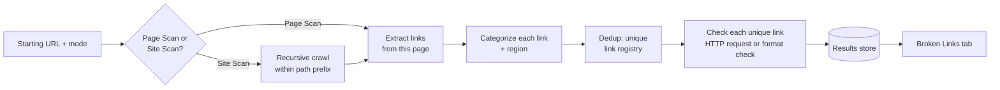

# MavDitto — Broken Link Inspector: Plan & Design Guide

Sep 23, 2026 · @Ashzaeen

## Overview

The Broken Link Inspector is a new module in MavDitto that scans a UTA page, or an entire subsite, for broken, redirected, or otherwise problematic links. It's independent of the migration-comparison pipeline; it's a link-health audit tool the Web Publishing team can point at any page or subsite on demand, whether or not a migration is involved.

## Goals

- Given a single URL, check every link on that page and report anything broken, redirected, or otherwise worth a look (Page Scan)
- Given a single URL, optionally crawl every page nested under that URL's path prefix and check every link found anywhere along the way, including links that point outside the crawled section or off the domain entirely (Site Scan)
- Never miss a link: cover every category of destination a link can point to (pages, documents, images, media, anchors, email, phone), not just plain internal page links
- Let the reviewer control noise: header/navbar/footer links are excluded by default since they repeat identically on every page, but can be opted into per scan
- Deduplicate: a link repeated across many pages is only ever checked once, with every page it appeared on recorded against that single result
- Report is grouped by category, filterable by status, and exportable, and clearly identifies what kind of resource each broken link pointed at (a PDF, an image, a phone number, etc.), not just that it's broken

## Scan modes

**Page Scan** — checks only the one URL provided. Extracts every link on that single page and checks each one. No crawling.

**Site Scan** — starts at the provided URL and recursively discovers every page nested under that URL's path prefix (e.g. given `.../admissions/`, it crawls `.../admissions/apply/`, `.../admissions/apply/graduate/`, and so on, however deep that goes) — the same discovery logic MavDitto already uses for migration pairing.

Crawl scope and check scope are different things:

- **Crawl scope** (which pages get recursively visited to find more links): only pages under the starting URL's path prefix.
- **Check scope** (which links get validated): every link found on any crawled page, no matter where it points — including a different section of the same UTA domain, or an entirely external site. Those out-of-scope destinations are checked (does it load, does it 404) but not recursively crawled themselves.

This means Site Scan will surface, for example, a dead link to an external vendor page even though that vendor's site is nowhere near the subsite being scanned — it just won't go crawling around inside the vendor's site looking for more links.

**Naming**: going with **Page Scan** / **Site Scan**.

## Link categories

Every link found is checked, and every link is also labeled by category so a reviewer instantly knows what kind of thing broke, not just that something did:

| Category | What it covers |
| --- | --- |
| Internal page (in scope) | Same domain, path falls under the scanned path prefix |
| Internal page (other section) | Same domain, but outside the scanned path prefix |
| External page | A different domain entirely |
| Document | Linked file that isn't a webpage: PDF, Word (.docx), Excel (.xlsx), PowerPoint (.pptx), plain text, zip, etc. |
| Image | Link target is an image file (.jpg, .png, .gif, .svg, .webp), whether it's an `<a>` wrapping an `` or a direct link straight to an image file |
| Media | Link target is audio/video (.mp4, .mp3, .mov, etc.) |
| Anchor / fragment | A `#section-id` link, to a spot on the same page or another page — checked by confirming an element with that id actually exists at the target, not just that the target page loads |
| Email | `mailto:` links — format-validated, not fetched (see Status tiers) |
| Phone | `tel:` links — format-validated, not fetched |

This taxonomy is what drives the grouping in the dashboard report.

## Status tiers

Every checked link resolves to one of these:

| Status | Meaning | Counts as "broken"? |
| --- | --- | --- |
| OK | Resolves normally (2xx) | No |
| Redirected | Resolves via a 3xx redirect — not broken, but flagged so someone can update the link to point straight at the final destination | No (flagged separately) |
| Broken | 404, or any other 4xx/5xx that isn't a permissions issue | Yes |
| Broken anchor | Target page loads fine, but the `#section-id` doesn't exist on it | Yes |
| Restricted | 401/403 — could be an intentional login wall rather than a real problem, so kept as its own tier instead of lumped in with Broken | No (flagged for review) |
| Unreachable | Timed out, DNS failure, connection refused — couldn't get a status code at all | Yes |
| Format invalid | A `mailto:`/`tel:` link that isn't formatted like a real email or phone number | Yes |

Only **Broken**, **Broken anchor**, **Unreachable**, and **Format invalid** count toward the headline "X broken links found" number. **Redirected** and **Restricted** are shown in the report but don't inflate that count, since neither is necessarily an actual problem.

## Header / navbar / footer checkboxes

Three checkboxes — **Header**, **Navbar**, **Footer** — all **unchecked by default**. Links inside `<header>`, `<nav>`, and `<footer>` elements (or, as a fallback for sites that don't use semantic HTML, elements matching common header/nav/footer class or role patterns) are excluded from checking unless the corresponding box is checked. Main content links are always checked regardless of these boxes.

**Why unchecked by default**: header/navbar/footer links are usually identical across every page on a subsite, so checking them by default means re-checking the exact same handful of links dozens or hundreds of times over during a Site Scan — wasted work for zero new information after the first page. Opting in makes sense when someone specifically wants to audit the site-wide nav/footer itself.

**Deduplication applies globally, not just here**: any link that appears identically on multiple pages (in body content, or in header/nav/footer if opted in) is only ever checked once. The report then shows every page it was found on, so a broken nav link doesn't show up as 40 separate rows — it shows up once, with a "found on 40 pages" note that expands to the full list.

## Architecture



1. **Crawl** — for Site Scan, recursively discover every page nested under the starting URL's path prefix (reuses the same crawl logic as MavDitto's URL Discovery step). For Page Scan, this step is skipped entirely.
2. **Extract links** — for every crawled page, parse the full DOM (not just main content, since header/nav/footer need to be identifiable) and pull every `<a href>`, image link, and any other linkable element.
3. **Categorize** — label each link by destination type (see Link categories) and by region (main content vs. header/nav/footer).
4. **Dedup** — collapse identical links found across multiple pages into a single entry, tracking every page it appeared on.
5. **Check** — for each unique link: an HTTP request (HEAD, falling back to GET if HEAD isn't supported) for page/document/image/media/external links; a fetch + DOM check for anchor links; a format/regex check for `mailto:`/`tel:` links. Respect rate limits, especially for external domains — lower concurrency and back off more aggressively than for internal checks.
6. **Report** — persist results (status, category, region, all found-on pages) so the dashboard tab can filter/group without re-checking anything.

## Dashboard tab: Broken Links

A new tab in MavDitto's existing dashboard, alongside the migration-validation view.

**Setup panel (top)**

- URL input
- Mode toggle: Page Scan / Site Scan
- Checkboxes: Header, Navbar, Footer (all unchecked by default)
- Run Scan button
- For Site Scan: live progress while running ("34 pages crawled, 12 queued")

**Summary header**

- Total links checked
- Count broken / redirected / restricted / unreachable / OK
- Total pages crawled (Site Scan only)

**Results table**

- Grouped by category (collapsible sections: Internal — in scope, Internal — other section, External, Document, Image, Media, Anchor, Email, Phone)
- Columns: Link, Status (color-coded badge), HTTP code, Found on (page count, expandable to the actual list), Link text/label
- Filters: by status, by category, by region (main / header / nav / footer)
- Sort: worst-first by default (Broken/Unreachable, then Broken anchor/Format invalid, then Redirected/Restricted, then OK)

**Row interaction**

- Expanding a row shows every page it was found on, each as a clickable link

**Export**

- "Export broken links" button → CSV, for handing off to a content editor to fix

## Repo additions

This lives as a new module inside the existing MavDitto codebase, reusing its crawler where possible:

```
mavditto/
├─ src/
│  └─ link_checker/
│     ├─ crawl_site.py       # recursive crawl scoped to path prefix (Site Scan)
│     ├─ extract_links.py    # full-DOM link extraction + header/nav/footer region detection
│     ├─ categorize.py       # assigns each link a category from the taxonomy
│     ├─ dedup.py            # collapses repeated links into one entry with all found-on pages
│     ├─ check_links.py      # HTTP/format checking per link, rate-limit aware
│     └─ pipeline.py         # orchestrates Page Scan / Site Scan end to end
├─ dashboard/
│  └─ tabs/
│     └─ broken_links.py     # new dashboard tab, reads from the results store
```

**Suggested build order**: `extract_links.py` → `categorize.py` → `check_links.py` (get Page Scan fully working first) → `dedup.py` → `crawl_site.py` (extend to Site Scan) → `pipeline.py` → `dashboard/tabs/broken_links.py`.

## Build phases

| Phase | Scope | Deliverable |
| --- | --- | --- |
| 1. Link extraction | Pull every link + category + region from a single page | Script outputting a labeled link list for one URL |
| 2. Link checking | HTTP/format check on that list, tagged with a status tier | Same list, now with status per link |
| 3. Page Scan complete | Wire extraction + checking together, add basic result output | Working Page Scan end to end |
| 4. Dedup | Collapse repeats, track found-on pages | Verified against a page with repeated nav/footer links |
| 5. Site Scan crawl | Recursive discovery scoped to path prefix | Crawler producing a full page list for a test subsite |
| 6. Site Scan complete | Combine crawl + extraction + dedup + checking | Working Site Scan end to end on a real UTA subsite |
| 7. Dashboard tab | Build the Broken Links tab: setup panel, summary, grouped results, filters | New tab live in MavDitto's dashboard |
| 8. Export | CSV export of broken links | Working export button |

Phases 1–4 are worth nailing on Page Scan alone before touching the crawler — it's a much smaller surface to debug link categorization and checking logic against.

## Open questions / edge cases

- **Redirect chains**: should a link that redirects through multiple hops before landing show every hop, or just the first and final URL? Leaning toward first → final for readability, with the full chain available on click.
- **JS-rendered nav/footer**: if header/nav/footer are injected client-side (common in some Sitecore/WordPress themes), Playwright rendering (already used elsewhere in MavDitto) should catch them, but worth confirming on a real page early.
- **Very large subsites**: Site Scan needs a sane page cap (and a clear "stopped early" message) so an accidentally huge crawl doesn't run forever — what's a reasonable default cap?
- **Re-scanning**: should re-running a scan overwrite the previous results, or keep history so link health can be tracked over time? MVP can just overwrite; history is a natural follow-up feature.
- **Rate limiting on external checks**: some external sites may block or slow down repeated automated requests — needs backoff and probably a lower concurrency ceiling than internal checks.
- **Auth-gated pages**: pages behind a login show as Restricted rather than Broken, but won't be crawled further for more links — acceptable for MVP, but worth flagging to whoever reviews results so it isn't mistaken for "nothing to see here."
