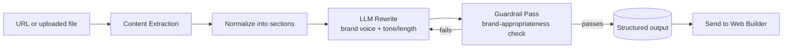
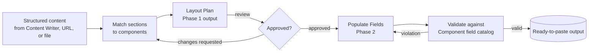
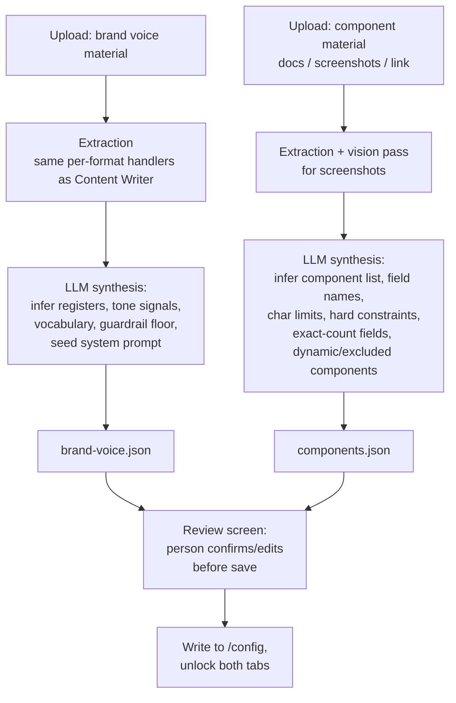

# MavDitto — Content Writer & Web Builder: Plan & Design Guide

Sep 24, 2026 · @Ashzaeen

## Overview & goals

Two new LLM-powered tabs, designed as one pipeline rather than two disconnected tools:

**Content Writer** — given a link to an old page, or an uploaded file (PDF, Word, PPT, Markdown, Excel, or an image), rewrites the content in UTA's voice. Solves a real, recurring pain point: a client hands over a PPT or PDF and it needs to become clean, web-ready copy, in UTA's voice, not a copy-paste of slide bullet points.

**Web Builder** — picks up where Content Writer leaves off. Given the same kind of input (a URL, or an uploaded file), it decides how to lay that content out using UTA's actual Sitecore component library, so the output isn't just text but a concrete, buildable page.

**Why one pipeline**: Content Writer produces clean, sectioned copy; Web Builder maps that copy onto real components. A "Send to Web Builder" handoff lets someone run both in sequence, but each also works standalone — someone who already has good copy can skip straight to Web Builder, and someone who just needs better writing doesn't have to touch layout at all.

**Shared goal for both**: whatever tone or length is chosen, the output must stay recognizably, appropriately UTA — never generic AI copy that happens to be about UTA.

## Brand voice profile (seed version)

A quick first-pass sample (UTA's Mission page, an Admissions "Apply" page, and a few instructional/FAQ pages) already shows UTA doesn't have one voice — it has (at least) two distinct registers depending on audience. This seed profile is enough to build against; the full version (Quick first pass → full crawl-based version, per earlier discussion) should broaden the sample size once the crawler exists.

**Register 1 — Institutional** (mission/about/policy pages): formal, third-person, no contractions, values-forward nouns ("collaboration," "excellence," "innovation," "integrity"). Sentences run longer and more compound. Example: *"The University is committed to providing access and ensuring student success, and to a culture of innovation, entrepreneurship, and commercialization of discoveries by our community of scholars."*

**Register 2 — Prospective-student / service** (admissions, how-to, FAQ pages): warm, second-person ("you," "you're"), plain and direct, occasional exclamation for encouragement, step-by-step instructional structure. Example: *"Applying for admission is easy at UTA and we're here to support you every step of the way!"*

**Consistent across both registers**: plain vocabulary, minimal jargon, short-to-medium sentences, specific facts cited with sources rather than vague superlatives (e.g. citing U.S. News & World Report rather than saying "top-ranked").

**Seed system prompt guidance for Content Writer**:

- Detect or ask which register the target page calls for (institutional vs. prospective-student/service) and write in that register by default
- Never let a requested tone (more casual, more formal, punchier) override UTA's baseline: no slang, no overclaiming, no unsourced superlatives, always plausible as something UTA's own Marketing, Messaging, and Engagement office would publish
- Prefer concrete facts and sourced figures over generic marketing language
- Second person is the default for anything audience-facing (admissions, current students, prospective students); third person for institutional/policy content

**Tone options exposed to the user**: a small set (e.g. Warmer / More formal / More concise / More detailed) that adjust within-register, not across the UTA-appropriateness floor — the tone selector changes style, never changes whether the output sounds like UTA.

## Content Writer: inputs & modes

**Input options**

- A URL to an old page (crawled and extracted, reusing MavDitto's existing fetch/extract infrastructure)
- An uploaded file: PDF, Word (.docx), PowerPoint (.pptx), Markdown (.md), Excel (.xlsx), or an image (for image-based content like a flyer or a screenshot of text)

**Tone options** (see Brand voice profile for the floor these sit above): Warmer, More formal, More concise, More detailed — selectable independently, not mutually exclusive

**Length options**: Match original length, Condense (shorter web-ready summary), Expand (fill out thin source material, e.g. a sparse PPT slide) — useful specifically for the PPT/PDF pain point, where slide bullet points are often too terse to read as web copy as-is

**Output register**: auto-detected from context (see Brand voice profile), with a manual override if the tool guesses wrong (e.g. a page that reads as prospective-student-facing but is actually meant for current students)

## Content Writer: architecture & pipeline



1. **Content Extraction** — pulls text (and notes images/media present) from the source: for a URL, reuses MavDitto's fetch/extract; for files, uses format-specific extraction (PDF text extraction, python-docx for Word, python-pptx for PowerPoint — pulling slide titles and bullet text separately, openpyxl for Excel, a vision-capable model pass for images).
2. **Normalize into sections** — converts whatever structure the source had (slides, cells, paragraphs) into a common intermediate format: a title, an ordered list of sections each with its own heading and body text, and a list of any images/media referenced. This is what makes PPT-to-web-copy actually work: slide-by-slide bullets become web-appropriate sections, not a bullet dump.
3. **LLM Rewrite** — the extracted/normalized content plus the brand voice system prompt plus the chosen tone/length options go to the LLM, which produces rewritten copy per section.
4. **Guardrail Pass** — a second LLM call (or a rules-based check) verifies the rewrite against the brand-appropriateness floor from the Brand voice profile (no slang, no unsourced superlatives, register consistency) independent of whatever tone was requested. Anything that fails goes back through the Rewrite step with the specific issue flagged.
5. **Structured output** — persists the final sectioned copy, ready either to display for review/editing or to hand off to Web Builder.

## Content Writer: output format

Structured, not a single text blob — this is what lets Web Builder map pieces onto specific components rather than guessing where to split a wall of text:

```json
{
  "page_title": "string",
  "register": "institutional | prospective-student",
  "sections": [
    {
      "heading": "string | null",
      "body": "string",
      "kind": "intro | body | cta | fact-list | quote | faq-item",
      "links": [{"text": "string", "url": "string"}],
      "media_refs": ["description of image/media originally present, if any"]
    }
  ]
}
```

`kind` is a lightweight hint (not a hard classification) that Web Builder uses as a starting signal for component matching — e.g. a `fact-list` section hints at Datapoint Listing, a `cta` section hints at one of the CTA components. Every section keeps its own heading/body/links so Web Builder can place them independently rather than needing to re-split a single merged output.

## Web Builder: inputs & two-phase output

**Input options** (same shape as Content Writer, so either tool can be an entry point): a URL to an old page (typically Cascade or WordPress), an uploaded file (PDF, Word, PPT, Markdown, Excel, Images), or — the common case — Content Writer's structured output handed off directly.

**Phase 1: Layout plan** — given the content, propose which UTA components to use, in what order, and why. No fields populated yet. Output looks like:

| Order | Component | Maps to | Rationale |
| --- | --- | --- | --- |
| 1 | Hero Landing | Page title + intro section | Primary hero, supports title/subheading/body/link — fits the intro |
| 2 | Datapoint Listing | The 3 stats in section 2 | Section reads as a fact-list; component is built for exactly this |
| 3 | Accordion | The FAQ section | Rich text, unlimited length, ideal for FAQ-style content |

The person reviews this plan — approves it, or asks for changes (swap a component, reorder, drop a section) — before anything gets populated.

**Phase 2: Populated fields** — once the plan is approved, Web Builder fills in each chosen component's actual fields (see Component field catalog), respecting every hard constraint (character limits, exact image/link counts) from the catalog. Output is ready to paste directly into Sitecore, field by field, component by component.

## Web Builder: selection logic & hard constraints

**Matching signals**, in priority order:

1. Section `kind` hint from Content Writer's output (fact-list → Datapoint Listing, cta → a CTA variant, faq-item → Accordion)
2. What media is available — a section with 4 images available fits Four Image Grid or Right Grid Content Block with Links; a section with zero images rules those out entirely
3. Content length — Accordion and CTA Rich Text/Link List support unlimited text; several Hero and CTA variants cap at 100/198/280 characters, so long sections get steered away from those regardless of how well the topic fits

**Hard constraints the matcher must respect** (from the Component field catalog):

- **Exact-count fields, not maximums**: Four Image Grid and Right Grid Content Block with Links only work with *exactly* 4 images — 3 or 5 breaks the component. If the content doesn't naturally have exactly 4 image-worthy items, these are excluded, not padded or truncated to fit.
- **Character limits are hard caps**: e.g. Hero Landing's Title (100) and Body (280), CTA Accent's Body (198). Web Builder must fit or trim to these, never overflow and hope Sitecore truncates gracefully.
- **Components that don't take manual copy**: Featured News, Featured Topic Listing, and News Topic Archive pull content automatically from a folder/topic — they're structural placement suggestions only ("a news feed could go here"), never destinations for Content Writer's text.
- **Shared-copy components**: several Hero variants (Compact, Image Full, Video Full, Gradient) don't have their own title/body fields at all — they inherit from the page's own Title/Description. Web Builder needs to write to the *page-level* fields for these, not a component field.

**When nothing fits well**: if a section doesn't map cleanly to any component (rare, but real — e.g. a complex table from an uploaded Excel file), the plan says so explicitly rather than forcing a bad fit, and suggests the closest approximation with a flagged caveat.

## Web Builder: architecture & pipeline



1. **Match sections to components** — runs the selection logic above against every section in the structured input, producing candidate component assignments.
2. **Layout Plan** — formats the matches into the reviewable table (see Phase 1 above) with rationale per row.
3. **Approval loop** — the person reviews, and any requested change (swap, reorder, drop) re-runs matching with that constraint locked in, rather than regenerating the whole plan from scratch.
4. **Populate Fields** — once approved, generates the actual field content per component (titles, bodies, links, image references) using the section content, trimmed/adapted to fit each component's exact limits.
5. **Validate against the catalog** — a deterministic check (not an LLM judgment call) confirms every populated field respects its component's real constraints — character counts, exact image/link counts, required sub-items. Anything that fails goes back to Populate Fields with the specific violation.
6. **Ready-to-paste output** — organized component-by-component, field-by-field, in the order from the approved plan.

## Dashboard tab designs

Both are new tabs in the left icon rail (per the Acrobat-inspired rehaul), each with their own icon and tile — equal billing with Migration Validator, Alt Text Generator, and Broken Link Inspector.

### Content Writer tab

**Setup panel**

- Input toggle: URL / Upload file
- Tone options (multi-select chips): Warmer, More formal, More concise, More detailed
- Length option (single-select): Match original, Condense, Expand
- Register override (optional dropdown): Auto-detect, Institutional, Prospective-student
- "Rewrite" button

**Results view**

- Section-by-section display: original content (collapsed by default) next to rewritten content
- Per-section regenerate button, for when one section needs another pass without redoing the whole page
- "Send to Web Builder" button, prominent, once results are ready
- Export as plain text/Markdown, for anyone who just wants the copy

### Web Builder tab

**Setup panel**

- Input toggle: URL / Upload file / Use Content Writer output (auto-selected when arriving via handoff)

**Phase 1 view — Layout Plan**

- The plan table (Order / Component / Maps to / Rationale) from the architecture above
- Per-row controls: swap component (shows valid alternatives only, filtered by the same hard constraints), remove row, reorder
- "Approve & Populate Fields" button

**Phase 2 view — Populated Fields**

- One card per component in plan order, each showing every field with its value and its limit (e.g. "Title: 42/100") so it's visually obvious nothing overflows
- Copy-to-clipboard per field and per component
- Flag icon on any component using page-level fields (Hero Compact, Image Full, etc.) noting that those fields live on the parent page, not the component itself

## Component field catalog

The authoritative reference Web Builder's matcher and populator both read from. Pulled from UTA's live Digital Design System component pages.

### Hero components

| Component | Fields & limits | Notes |
| --- | --- | --- |
| Gradient Hero | Title 100, Body 280 (from page Title/Description) | No component-level copy field — pulls from the parent page |
| Hero Compact | Title 100, Body 280 (from page Title/Description) | Selected via "Hero Full or Compact" component; no link |
| Hero Image Full | Title 100, Body 280 (from page Title/Description) | Most-used hero site-wide; also via "Hero Full or Compact" |
| Hero Video Full | Title 100, Body 280 (from page Title/Description) | Vimeo Pro progressive link only; no audio-dependent videos; requires fallback image |
| Hero with Link | Title 100, Body 280, Link 50 | One link, styled as an orange CTA button |
| Hero Landing | Title 100, Subheading 100, Body 280, Links 50 | Primary landing-page hero; eyebrow text + photo |
| Hero Landing with Links | Title 100, Body 280, Links 50 (up to 3) | 'New Look' only — don't mix with classic components |
| Hero with Slate | Hero Title 100, Hero Description 280, Slate Form Title 100, Slate Form Description 150 | Requires a Slate Form ID |
| Quick Facts Hero | Title 100 (from page Title), Body 280, Quick Fact 200 (up to 4) | Good fit for program/event pages needing scannable stats |

### CTA components

| Component | Fields & limits | Notes |
| --- | --- | --- |
| CTA Accent | Title 100, Body 198, Links 50 (up to 2) | Single-line-announcement use case |
| CTA Billboard | Title 100, Body 298, Links 50, Secondary Text 198 | Only component with a "PS" line; 1 link |
| CTA Link List | Title/Description/Tagline unlimited, Buttons 50, Links 50 | 2 main links + up to 5 more (7 total) |
| CTA Rich Text | Title/Description unlimited, Buttons 50 | Despite the name, no actual rich text; up to 2 links |
| CTA Right Rail | Title/Description unlimited, Link 50 | Works in left or right rail |
| CTA Right Rail Accent | Title/Description unlimited, Link 50 | Same as Right Rail, blue accent styling |
| CTA Right Rail Accent Rich Text | Title/Description unlimited, Link 50 | Adds rich text; copy must be wrapped in `<p>` tags |
| CTA Right Rail Detail | Title/Description unlimited, Link 50 | Same as Right Rail, adds rich text in description |
| CTA Right Rail Image | Title 100, Description 200, no links | Title becomes the click target, not a separate button |
| CTA Right Rail Listing | Parent Title 100/Link 50; child Title/Date/Venue unlimited | Built for events/meetings/seminars; \~5 recommended |
| CTA Right Rail Quick Links | Title 100, Link 50 | Up to 5 links |
| CTA with Links | Title/Description unlimited, Links 50 | **Exactly 4 images required**; 3+ links recommended |

### Content blocks & cards

| Component | Fields & limits | Notes |
| --- | --- | --- |
| Accordion | Title/Body unlimited | Full rich text (images, links); best for FAQs, T&Cs |
| Announcement Items | Title 100, Description 298, Link 50 | \~3 listings recommended, technically unlimited |
| Circle Top Profile Card | Title 100, Body 198 | Circular image top; blue or dark gray variant |
| Component Subject Carousel | Tab Label 100, Title 100, Body 198, Links 50 | Auto-advancing; nests Datapoint Listing/Featured Link List/Story Card |
| Datapoint Listing | Parent: Title/Description unlimited, Link 50. Child: Ranking 5, Title 100, Reference 50 | Static or dynamic (counts up) sub-items, optional icons |
| Event Countdown | Title/Description unlimited, Link 50 | Full/Compact and Light/Dark mode variants |
| Feature Interest | Title 100, Description 198, Link 50 | **Exactly 4 images**; description inside or below image |
| Featured Link List | Title 100, Link 50 | Up to 7 links |
| **Four Image Grid** | Title unlimited, Image CTA 50 | **New Look only. Exactly 4 images required** — not a maximum |
| Left Image Vertical Listing | Parent: Heading/Description unlimited. Sub-item: Title/Description/Button Link 1&2 unlimited | Very flexible; has a 'new look' variant — don't mix with classic |
| **Right Grid Content Block with Links** | Title/Description unlimited, Main CTA 50, Image CTA 50 | **New Look only. Exactly 4 images required** in the grid |

### Dynamic / auto-populated components

These pull content automatically from a folder or topic rather than taking manually authored copy — Web Builder should treat them as structural placement suggestions ("a news feed could go here"), never as a destination for Content Writer's text:

- **Featured News** — displays 5 articles, manually selected or auto-populated from a folder
- **Featured Topic Listing** — auto-pulls news from a folder filtered by topic, into 3 cards + 2 right-rail items
- **News Topic Archive** — returns all articles from a branch tagged with a given topic

## White-label architecture: forking beyond UTA

UTA is the packaged default, not a hardcoded assumption. Brand voice and the component catalog are external config, not code, so anyone can fork the repo and point both tools at their own brand and their own CMS's components.

**First-run setup wizard.** On first launch, MavDitto asks one question: *Is this for UTA?*

- **Yes** — the app copies in the pre-built UTA config (the brand voice profile and Sitecore component catalog already documented above) and both tabs work immediately.
- **No** — Content Writer and Web Builder each show a **Configure** screen instead of their normal setup panel, until config exists. The Configure screen asks for:
  - Brand voice material: sample pages, a style guide, or any writing the org considers representative (URL or file upload — same input pipeline Content Writer already uses).
  - Content design material: their CMS's component library, accepted freeform — docs, screenshots, or a link to a live design-system/component-library page. No structured template required; the setup engine is responsible for turning freeform material into the structured catalog shape the Web Builder needs (the field-by-field tables in the Component field catalog section above are the target shape it produces).

**Config storage.** Generated config is written to plain files in the repo, not a database — `/config/brand-voice.json` and `/config/components.json`. Both tabs read from these two files at runtime; the UTA-packaged versions are just pre-committed copies of the same shape. Keeping this as flat files (versionable, diffable, editable by hand) rather than a DB matches the fork-and-run use case — no migrations, no schema setup beyond what's already needed for the app itself.

**Re-running setup later.** Configuration isn't locked to first run. A Settings page exposes "Redo brand voice" and "Redo component catalog" actions that re-open the same intake flow and overwrite the corresponding config file (with a confirmation step, since this invalidates in-flight Content Writer/Designer sessions built against the old config).

**Setup engine (freeform ingestion).** Given an Anthropic API key (the same key the rest of the app uses for rewriting/mapping), a setup pipeline converts whatever raw material the person uploads into the two structured config files, including the appropriateness guardrail — inferred alongside the rest of the voice profile and stored inside brand-voice.json rather than fixed to UTA's tone floor:



The review screen matters because inferred component constraints (an exact-count field, a hard character cap) are exactly the kind of thing that's cheap to get wrong silently and expensive to get wrong in a live CMS — the person confirms or corrects the inferred catalog before it's saved, rather than the engine writing it straight through.

**Downstream effect on Web Builder's logic.** The selection logic and hard constraints described above (exact-count fields, character caps, dynamic components excluded from manual copy, shared-copy Hero-style variants) were written against UTA's catalog, but the *logic itself* is CMS-agnostic — it walks whatever `components.json` says, not a UTA-specific list. A non-UTA fork gets the same matching behavior once its own catalog is generated; nothing in the matching code should reference UTA by name.

## Repo additions and build order

New top-level pieces, layered so Content Writer can ship and be used before Web Builder or the setup engine exist:

```
/config/
  brand-voice.json          # UTA default, committed; overwritten per-fork by setup engine
  components.json           # UTA default, committed; overwritten per-fork by setup engine
/lib/extraction/
  pdf.ts  docx.ts  pptx.ts  xlsx.ts  vision.ts  url.ts   # shared by Content Writer intake AND setup-engine intake
/lib/content-writer/
  rewrite.ts                # tone/length/register pipeline, reads brand-voice.json
  guardrail.ts              # appropriateness floor check, reads brand-voice.json's guardrail floor
/lib/content-designer/
  match.ts                  # selection logic, reads components.json
  populate.ts               # phase 2 field population, respects catalog constraints
/lib/setup-engine/
  ingest-brand-voice.ts      # freeform material -> brand-voice.json shape (voice profile + guardrail floor)
  ingest-components.ts       # freeform material -> components.json shape
/app/setup-wizard/           # first-run "Is this for UTA?" flow
/app/settings/                # "Redo brand voice" / "Redo component catalog"
/app/content-writer/          # tab, setup panel + results view
/app/content-designer/        # tab, Configure screen (shown if components.json absent) + Phase 1/2 views
```

Build order:

1. **Extraction layer** (`/lib/extraction/`) — needed by both Content Writer and the setup engine, so it's built once, first.
2. **UTA config as static files** (`/config/*.json`) — hand-authored from the research already done in this doc, committed as the packaged default. This unblocks everything downstream without waiting on the setup engine.
3. **Content Writer** end to end, against the static UTA config — input intake, rewrite pipeline, guardrail pass, results view. Shippable and usable on its own.
4. **Web Builder** end to end, against the static UTA config — match logic, Phase 1 plan/approval, Phase 2 populate. Consumes Content Writer's output or its own direct input.
5. **Setup wizard + Settings reconfiguration UI** — the "Is this for UTA?" first-run screen and the later Settings redo actions. At this point they can just copy the static UTA config or leave `/config/*.json` absent (triggering the Configure screens) — no ingestion engine needed yet to exercise the UI.
6. **Setup engine** (`/lib/setup-engine/`) — freeform ingestion for non-UTA forks, plus the review screen before writing to `/config/`. Built last because it's the piece that only matters once someone actually forks the repo for a non-UTA org; UTA's own usage never touches it.

## Build phases / milestones

| Phase | Scope | Depends on | Outcome |
| --- | --- | --- | --- |
| 1 | Extraction layer + static UTA config files | — | `/lib/extraction/` working for all input types; `/config/*.json` committed |
| 2 | Content Writer (full) | Phase 1 | UTA staff can rewrite a page/file into brand voice, tone + length controls, guardrail pass |
| 3 | Web Builder (full) | Phase 1, Writer's output shape | UTA staff can turn rewritten (or raw) content into a Sitecore layout plan + populated fields |
| 4 | Setup wizard + Settings reconfiguration UI | Phase 1 | First-run "Is this for UTA?" flow; Configure screens for missing config; Settings redo actions |
| 5 | Setup engine (freeform ingestion) | Phase 4, extraction layer | A non-UTA fork can upload its own brand voice + component material and get a working `/config/` without manual authoring |

Phases 2 and 3 can run in parallel once Phase 1 lands, since Web Builder only needs Content Writer's *output shape* (the JSON schema), not a finished Content Writer. Phase 4's UI can be built in parallel with 2/3 as well — it doesn't depend on either tool's internals, only on whether `/config/*.json` exists. Phase 5 is the only strictly last piece.

## Open questions / risks

- **Guardrail floor for non-UTA forks.** Decided: the guardrail is regenerated per fork. The setup engine infers the appropriateness floor alongside the rest of the brand voice profile and stores it inside brand-voice.json, so each fork's floor matches its own brand rather than being fixed to UTA's.
- **Setup engine review screen UX.** The review-before-save step (confirm/edit inferred component constraints) needs its own design — it's effectively a smaller version of Web Builder's Phase 1 approval loop, applied to catalog *definitions* rather than page *content*. Worth checking whether that UI can be shared/reused rather than built twice.
- **Component catalog drift.** UTA's own component library can change over time (new components added, fields renamed) independent of any fork. Nothing here yet handles re-syncing the UTA static config when UTA's Digital Design System changes — right now that would mean manually re-authoring `/config/components.json`, the same as the initial build.
- **Multi-brand within one deployment.** Current design assumes one brand voice + one component catalog per running instance. If a university system with multiple sub-brands (e.g., a med school with its own voice) ever wants this, that's a different (multi-config) architecture not covered here.
- **Freeform ingestion accuracy.** Accepting screenshots/docs/links freeform (per your call) means the setup engine is doing real inference work — exact-count fields and character caps in particular are easy to miss from a screenshot alone. The review screen is the mitigation, but it's worth setting expectations that a freeform-ingested catalog will need more early correction than the hand-authored UTA one did.
