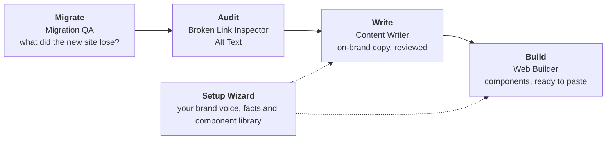

# MavDitto

**A content operations toolkit for university and enterprise web teams.** MavDitto covers the whole life of a site's content in one dashboard: check a migration for content that was *lost*, audit links and image descriptions, write copy in your brand's voice, and turn that copy into ready-to-paste components. People stay in the loop where it matters: you approve the layout plan, review the setup drafts, and see every draft's quality review.

> Independent, unofficial project, not affiliated with The University of Texas at Arlington. See the [disclaimer](#disclaimer).



Most site tools do one of these jobs. MavDitto covers them together: the migration check and audits find what is wrong, the Content Writer drafts and reviews the fix in your brand voice, and its output goes straight into the Web Builder, which places it into your real component library.

Its sharpest tool is the migration check. A plain text-diff cannot tell "we rewrote this paragraph for tone" from "we rewrote this paragraph and dropped the tuition figure." Given an old subsite and its replacement, MavDitto pairs up the pages, compares them structurally and semantically, and ranks them by how likely it is that content was **lost** rather than merely reworded. That distinction is the point of that tool.

## What's inside

Six tools, one dashboard:

| Tool | What it does | Needs an LLM key |
| --- | --- | --- |
| **Migration QA** | Pairs two sites' pages, compares them structurally and semantically, ranks them by likely content loss, and lists old pages with no counterpart at all. An optional LLM judge reads only the passages that similarity scores cannot settle. | Only for the optional judge |
| **Alt Text** | Writes a short, accurate description for one image, an upload, or every real image on a page. | Yes |
| **Broken Link Inspector** | Audits the links on one page or a whole subsite: broken, redirected, restricted, broken anchors, malformed email and phone links. | No |
| **Content Writer** | Rewrites a URL or uploaded file into a configured brand voice, or writes new copy from 15 templates. Every draft is reviewed and exports to Markdown, text, HTML, Word or PDF. | Yes |
| **Web Builder** | Maps structured content onto a component library: a reviewable layout plan first, then populated, ready-to-paste fields. | Yes |
| **Setup Wizard** | Turns your own material into the local brand-voice, knowledge-base and component configs the writing tools read. | Yes |

"Yes" means a paid API key for Claude, OpenAI or Gemini (your choice, set in the dashboard's Settings); there is no local-model option yet. Every call is checked against a spend cap first.

How the pieces connect, and a diagram for every pipeline, is in [docs/ARCHITECTURE.md](docs/ARCHITECTURE.md).

## Quick start

You need Python and Node 18+. It is developed and tested on Python 3.13 and Windows; the commands below use the Windows venv path, and macOS/Linux should use `.venv/bin/` instead (not tested there).

```bash
python -m venv .venv
.venv/Scripts/activate                      # macOS/Linux: source .venv/bin/activate
pip install -r requirements.txt
playwright install chromium
```

Then pick how you want to use it:

```bash
# A. The dashboard (all six tools)
cd dashboard-react && npm install && npm run build && cd ..
python -m src.server                        # open http://127.0.0.1:8000

# B. Just the migration check, from the command line
python -m src.run_pipeline --old https://old.example.edu --new https://example.edu --out data/run
python -m src.server --results data/run   # then browse the ranked results at http://127.0.0.1:8000
```

Optional: `python scripts/seed_config.py` installs a starter brand voice, knowledge base and component catalog so the writing and page-building tools work immediately. Migration QA, Alt Text and the Broken Link Inspector don't need it.

- **Semantic comparison** pulls torch (about 2.5 GB) and a 90 MB embedding model on first use. Add `--no-semantic` to skip both.
- **Your own config** is git-ignored. Use the starter profile above, or generate your own with the Setup Wizard. See [config/README.md](config/README.md).
- **Crawling:** requests are rate-limited per host, but robots.txt is only respected if you pass `--respect-robots` (or tick the box in the dashboard). Only scan sites you are authorized to scan.

## Documentation

| Doc | What is in it |
| --- | --- |
| [docs/ARCHITECTURE.md](docs/ARCHITECTURE.md) | 17 diagrams: system overview, API, every pipeline, the provider layer |
| [docs/migration-qa.md](docs/migration-qa.md) | Pairing, structural and semantic diff, risk scoring, the LLM judge, CLI usage |
| [docs/dashboard.md](docs/dashboard.md) | The React dashboard and the server behind it |
| [docs/code-map.md](docs/code-map.md) | What each module and folder is for |
| [docs/design/](docs/design) | Build plan, design system, per-tool design guides |

## Disclaimer

MavDitto is an independent, unofficial, open-source project. It is not affiliated
with, endorsed by, or supported by The University of Texas at Arlington (UTA).
The repository ships no credentials, crawl output or caches. The one UTA-related
thing it includes is an **optional starter profile** in `config/seed/uta/`,
derived from material UTA publishes on the public web (its editorial guidelines,
public news releases and public design-system site); every fact in it carries its
source URL. That data is UTA's, and "UTA" is UTA's mark. The profile is a
convenience and an example: use your own configuration for anything real, and only
point the tool at sites you are authorized to scan.

## Tests

```bash
pytest tests/ -q
```

All offline. About 640 tests run on a fresh clone; a few need a brand-voice, knowledge-base and component config and are skipped until you have one (the optional starter profile above makes all 786 run).

## License

[Apache License 2.0](LICENSE), copyright 2026 Ashzaeen Fatmi Khan. The optional UTA starter profile is UTA's material and is not covered; see [NOTICE](NOTICE).
