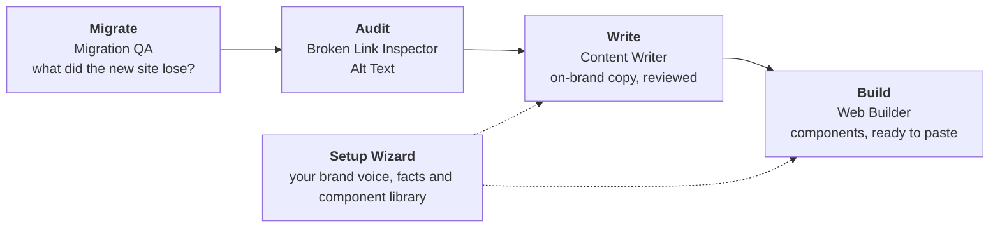

# MavDitto

**A content operations toolkit for web teams.** MavDitto covers the whole life of a site's content in one dashboard: check a migration for content that was *lost*, audit links and image descriptions, write copy in your brand's voice, and turn that copy into ready-to-paste components. Every tool shares the same fetching, extraction and LLM plumbing, and a person reviews the result at each step.



Most site tools stop at one of these jobs, usually reporting on a live site. MavDitto covers all of them in one place: the migration check and the audits tell you what is wrong, the Content Writer drafts and reviews the fix in your brand voice, and its output goes straight into the Web Builder, which places it into your real component library.

Its sharpest tool is the migration check. A plain text-diff cannot tell "we rewrote this paragraph for tone" from "we rewrote this paragraph and dropped the tuition figure." Given an old subsite and its replacement, MavDitto pairs up the pages, compares them structurally and semantically, and ranks them by how likely it is that content was **lost** rather than merely reworded. That distinction is the point of that tool.

## Disclaimer

MavDitto is an independent, unofficial, open-source project. It is not affiliated
with, endorsed by, or supported by The University of Texas at Arlington (UTA).
The repository ships no credentials, crawl output or caches. The one UTA-related
thing it includes is an **optional starter profile** in `config/seed/uta/`,
derived from material UTA publishes on the public web (its editorial guidelines,
public news releases and public design-system site); every fact in it carries its
source URL. That data is UTA's, and "UTA" is UTA's mark. The profile is a
convenience and an example: use your own configuration for anything real, and only
point the tool at sites you are authorized to scan.

## What's inside

Six tools, one dashboard:

| Tool | What it does | Needs an LLM key |
| --- | --- | --- |
| **Migration QA** | Pairs two sites' pages, compares them structurally and semantically, ranks them by likely content loss, and lists old pages with no counterpart at all. | Only for the optional judge |
| **Alt Text** | Writes a short, accurate description for one image, an upload, or every real image on a page. | Yes |
| **Broken Link Inspector** | Audits the links on one page or a whole subsite: broken, redirected, restricted, broken anchors, malformed email and phone links. | No |
| **Content Writer** | Rewrites a URL or uploaded file into a configured brand voice, or writes new copy from 15 templates. Every draft is reviewed and exports to Markdown, text, HTML, Word or PDF. | Yes |
| **Web Builder** | Maps structured content onto a component library: a reviewable layout plan first, then populated, ready-to-paste fields. | Yes |
| **Setup Wizard** | Turns your own material into the local brand-voice, knowledge-base and component configs the writing tools read. | Yes |

The LLM provider is your choice (Claude, OpenAI or Gemini), set in the dashboard's Settings, and every call is checked against a spend cap first.

How the pieces connect, and a diagram for every pipeline, is in [docs/ARCHITECTURE.md](docs/ARCHITECTURE.md).

## Quick start

```bash
python -m venv .venv
.venv/Scripts/python.exe -m pip install -r requirements.txt   # Windows; use .venv/bin/python elsewhere
.venv/Scripts/python.exe -m playwright install chromium
.venv/Scripts/python.exe scripts/seed_config.py               # optional: a starter brand voice, facts and component catalog

cd dashboard-react && npm install && npm run build && cd ..
.venv/Scripts/python.exe -m src.server                        # dashboard at http://127.0.0.1:8000
```

- **Semantic comparison** pulls torch (about 2.5 GB on disk) and a 90 MB embedding model on first use. It loads lazily, so `--no-semantic` never pays for it.
- **LLM keys** are only needed for the tools marked "Yes" above (and the optional judge). Add one in the dashboard's Settings.
- **Your own config** (brand voice, knowledge base, components) is git-ignored. Seed the starter profile with `scripts/seed_config.py` (it never overwrites your files without `--force`), or generate your own with the Setup Wizard. See [config/README.md](config/README.md).

Run a migration check from the command line instead of the dashboard:

```bash
python -m src.run_pipeline --old https://old.example.edu --new https://example.edu --out data/run
```

## Documentation

| Doc | What is in it |
| --- | --- |
| [docs/ARCHITECTURE.md](docs/ARCHITECTURE.md) | 17 diagrams: system overview, API, every pipeline, the provider layer |
| [docs/migration-qa.md](docs/migration-qa.md) | Pairing, structural and semantic diff, risk scoring, the LLM judge, CLI usage |
| [docs/dashboard.md](docs/dashboard.md) | The React dashboard and the server behind it |
| [docs/code-map.md](docs/code-map.md) | What each module and folder is for |
| [docs/design/](docs/design) | Build plan, design system, per-tool design guides |

## Tests

```bash
.venv/Scripts/python.exe -m pytest tests/ -q
```

All offline. About 640 tests run on a fresh clone; a few modules assert against a brand-voice, knowledge-base and component config and are skipped until you have one. Run `scripts/seed_config.py` and the whole suite runs: 786 tests.

## License

[Apache License 2.0](LICENSE). Copyright 2026 Ashzaeen Fatmi Khan. See [NOTICE](NOTICE) for the vendored
brand-voice method (also Apache-2.0) and for the status of the optional UTA starter profile, which is
UTA's material and is not covered by this license.
