# Architecture and diagrams

Every diagram is [Mermaid](https://mermaid.js.org/), which GitHub renders natively in light and dark. They are drawn from the code in [`src/`](../src) and [`dashboard-react/`](../dashboard-react), and the design reasoning behind them lives in [`docs/design/`](design).

**Contents**

1. [System overview](#1-system-overview)
2. [Dashboard routes](#2-dashboard-routes)
3. [Server API](#3-server-api)
4. [A comparison run, in the background](#4-a-comparison-run-in-the-background)
5. [Migration QA pipeline](#5-migration-qa-pipeline)
6. [How pages get paired](#6-how-pages-get-paired)
7. [Fetching a page](#7-fetching-a-page)
8. [Risk scoring](#8-risk-scoring)
9. [The LLM judge](#9-the-llm-judge)
10. [Broken Link Inspector](#10-broken-link-inspector)
11. [Alt Text](#11-alt-text)
12. [Content Writer](#12-content-writer)
13. [Web Builder](#13-web-builder)
14. [Setup Wizard](#14-setup-wizard)
15. [LLM provider layer and budget](#15-llm-provider-layer-and-budget)
16. [Local files and what is committed](#16-local-files-and-what-is-committed)

---

## 1. System overview

One browser app, one small standard-library HTTP server, and a set of tools that share the same fetching, extraction and LLM plumbing.

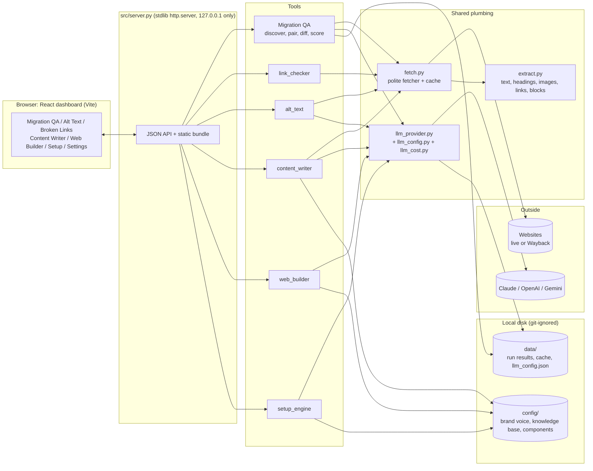

Design choices that shape the rest of this document:

- **The dashboard never fetches a page or loads a model.** The pipeline writes results to disk and the dashboard only reads them.
- **The server is localhost-only** because the run endpoints fetch arbitrary URLs on request.
- **Every LLM feature goes through one entry point**, so the active provider and the spend cap apply everywhere.

---

## 2. Dashboard routes

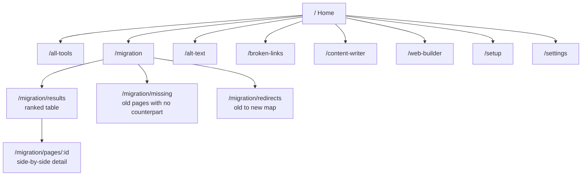

A persistent left icon rail has one icon per tool, never per view, so moving between tools does not change the shell. `/broken-links/*` redirects to `/broken-links`.

---

## 3. Server API

[`src/server.py`](../src/server.py) uses only the standard library. Endpoints, grouped by what they serve:

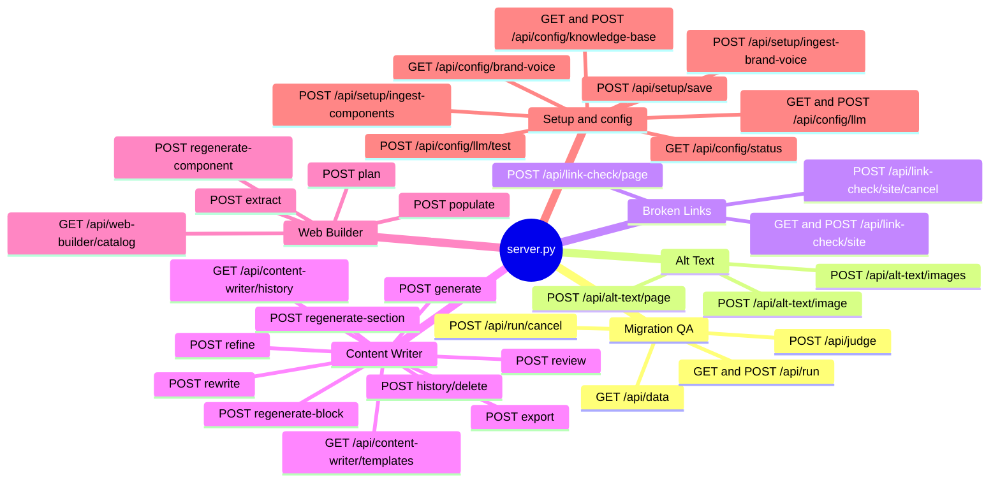

---

## 4. A comparison run, in the background

A run is minutes of network work, so it never blocks a request thread. The server starts it on its own thread, the page polls for progress, and the user can cancel. Site scans for broken links use the same shape.

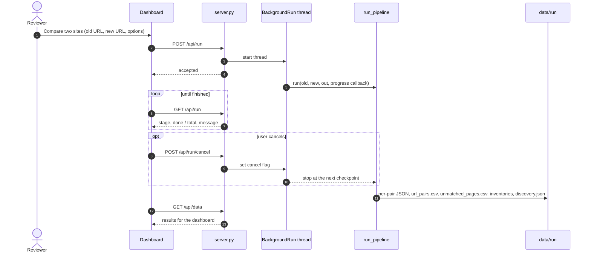

---

## 5. Migration QA pipeline

Two root URLs in, a ranked and explained list of pages out. The headline answer, which old pages have no counterpart at all, arrives **before** any content is compared, because a missing page cannot be diffed against a replacement it does not have.

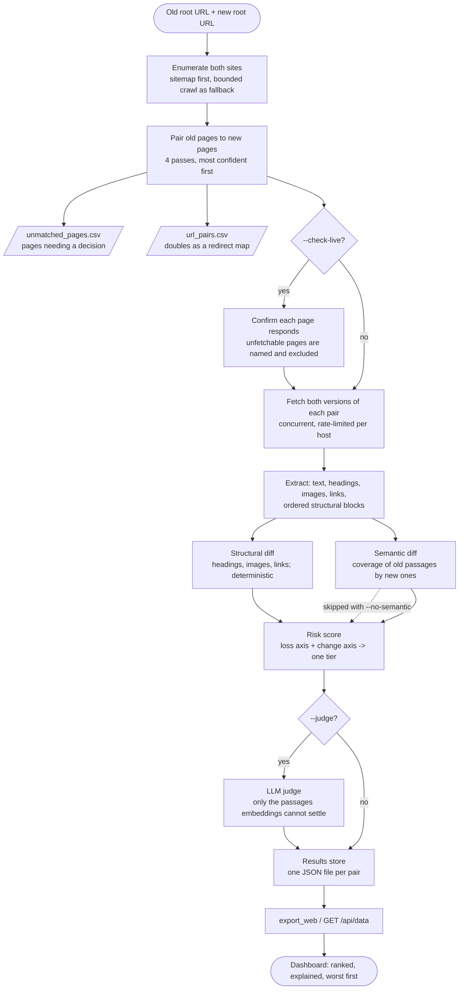

**Why two diffs.** The structural diff is cheap and blind to meaning; it sees a paragraph vanish only if a heading or link went with it. The semantic diff measures **coverage**: each old passage is matched to its best counterpart on the new page, and the passages with no good match are the finding. A whole-page similarity score would hide a dropped paragraph behind 90% unchanged text.

---

## 6. How pages get paired

Four passes, most confident first. Each pass claims what it is sure of before a looser one runs.

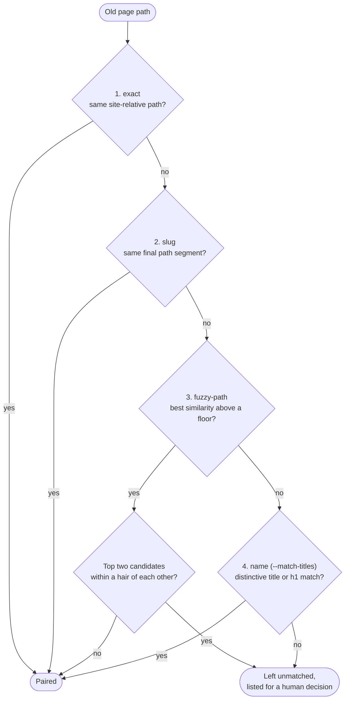

- CMS extensions are stripped first, so Sitecore's `/About.aspx` lines up with WordPress's `/about/`.
- An ambiguous match is refused on purpose: picking one of two near-equal candidates is a coin flip presented as a finding.
- `--match-titles` only trusts a title if it is distinctive on that site. If titles repeat (common on single-page apps), it falls back to each page's first `<h1>`, and if neither is distinctive it declines and says so.

---

## 7. Fetching a page

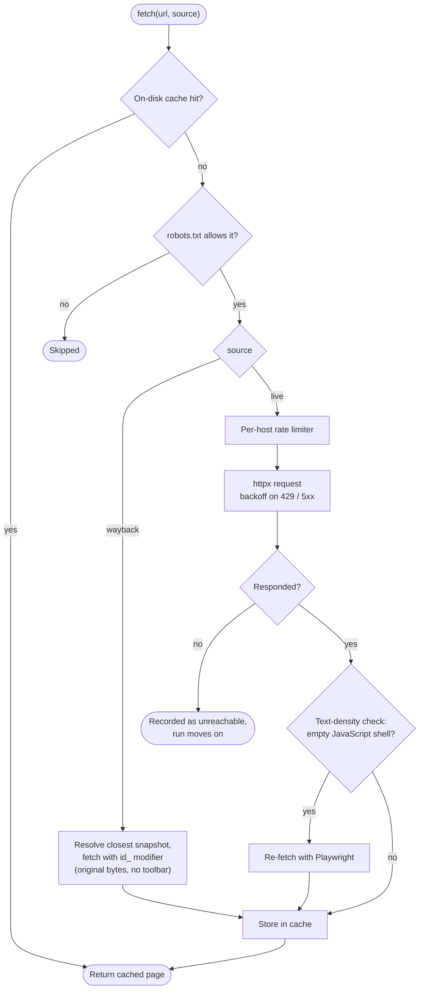

Concurrency overlaps *waiting*, not requests: every worker passes through the same per-host rate limiter. Bulk fetches use a tighter time budget than a single considered fetch, because in bulk a page that will not answer promptly *is* the finding.

---

## 8. Risk scoring

Each pair gets one tier from two separately scored axes. "Missing" is a different kind of evidence from "rewritten", not more of it: a page can be rewritten end to end and still say everything it used to.

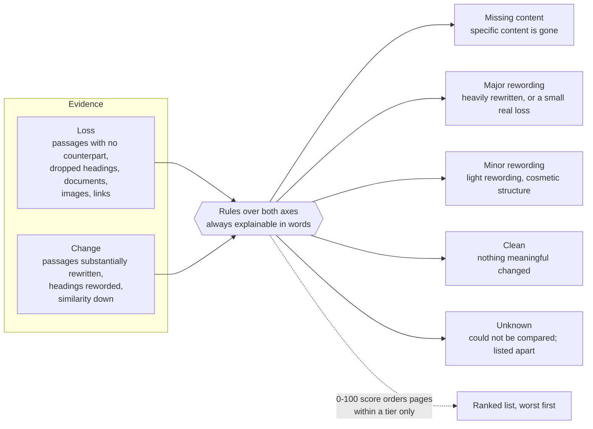

Structural signals are proxies, so they are weighted down when the evidence is thin. Every verdict carries its reasons, including `Clean` ones, and caveats appear on the rows that are not clean.

---

## 9. The LLM judge

Embedding similarity cannot separate "reworded" from "reworded and lost a fact": calibration measured a faithful paraphrase at 0.734 and a rewrite that silently dropped a GPA requirement at 0.764. The judge reads only what the semantic stage could not vouch for.

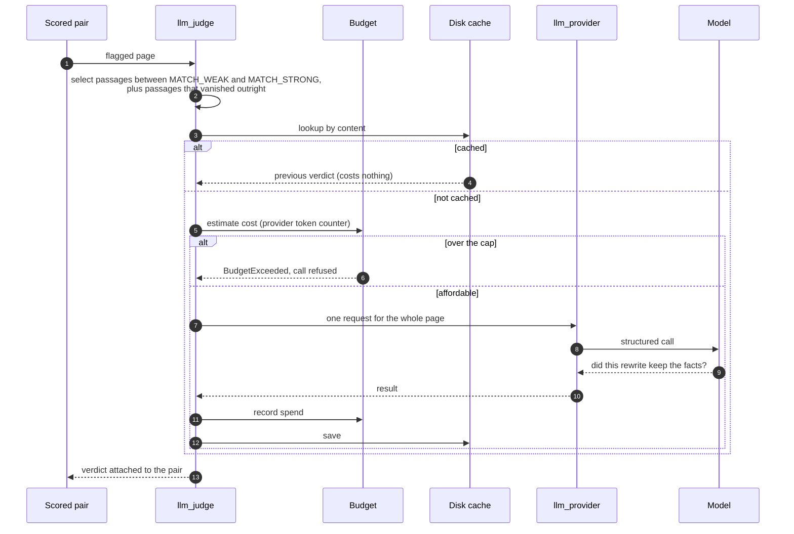

Cost control: only flagged pages and flagged passages are judged, one request per page rather than per passage, and a hard spend cap is checked **before** each call.

---

## 10. Broken Link Inspector

A link-health audit for one page or a whole subsite, independent of the migration pipeline. Both entry points share one extract, filter, dedupe, check pipeline; a site scan just crawls first.

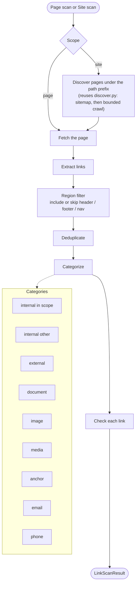

### How each link is checked

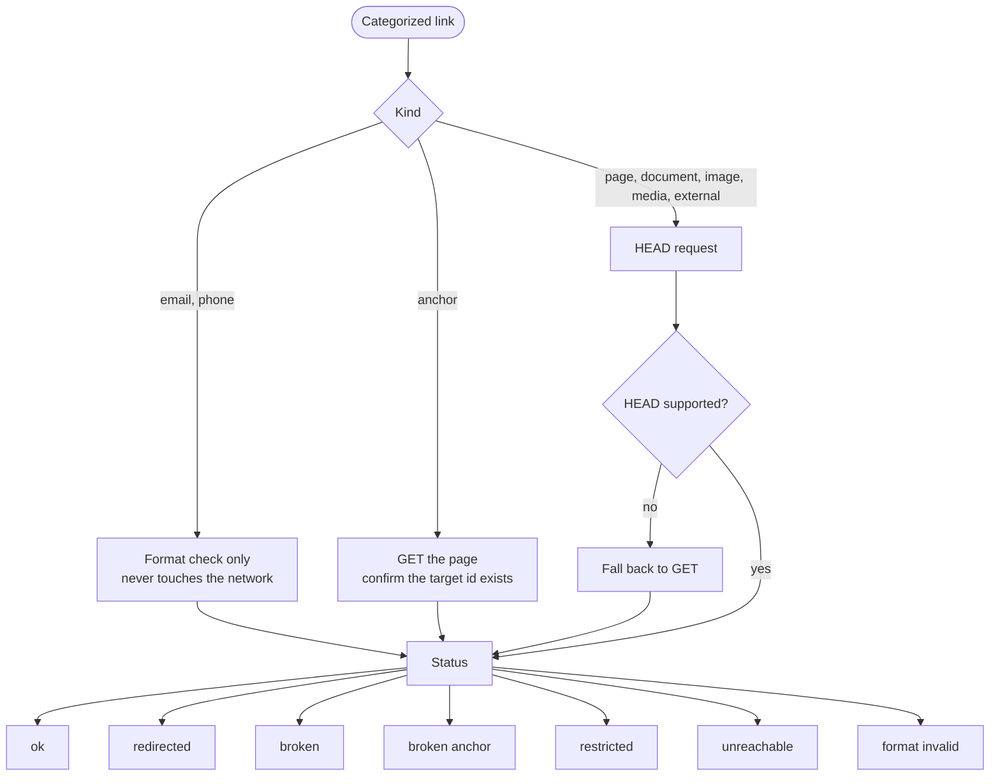

Order of categorization matters: a fragment marks an in-page jump regardless of the URL, and a file extension beats domain scoping, so a PDF hosted on the scanned domain is a Document, not an internal page. External hosts get their own longer per-host delay and a hard concurrency ceiling, independent of how many workers check internal links.

---

## 11. Alt Text

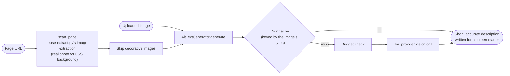

---

## 12. Content Writer

Rewrites a URL or uploaded file into a configured brand voice, or writes new copy from a template. A drafted variant is never shipped unreviewed: it is reviewed, redrafted against any blocking issue, and the final review always ships with it.

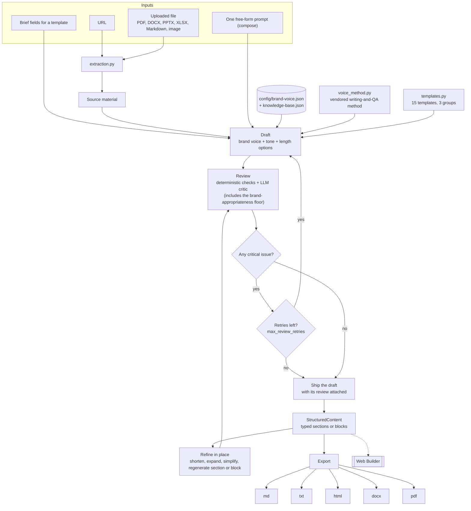

**Templates** ([`templates.py`](../src/content_writer/templates.py)):

| Group | Templates |
| --- | --- |
| Web page copy | rewrite a page, new page from a brief, academic program page, landing or campaign page, department or about page, compose (free-form) |
| News and events | news story, event announcement, press release, spotlight |
| Micro-copy and SEO | headlines and page titles, meta descriptions, calls to action, FAQ set, summary |

**Review.** The deterministic half catches what a model is unreliable at noticing in its own output: a banned word, a 170-character meta description, a statistic that appears nowhere in the source. The LLM critic judges voice, tone fit and generic filler. Suggestions never block; only critical issues do.

**Placeholders.** Anything invented to fill out a compose request (a placeholder quote, an illustrative figure, a link target, an image) is marked `is_placeholder` with a note and stays visibly labelled through rendering and export.

---

## 13. Web Builder

Maps structured content onto a component library in two phases. A human approves the layout plan in between, and that step is UI-driven, not code.

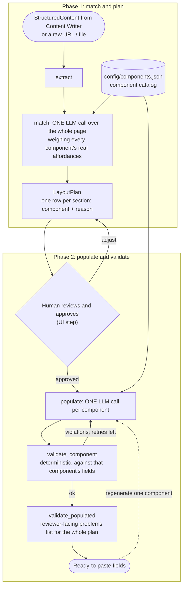

Population is type-aware per the catalog's field definitions: rich text comes back formatted, a button comes back as label, colour and rationale and never an invented URL (always one of the section's real links), an image field comes back as a role note plus a handoff to the Alt Text tool, and an enum field is constrained to its allowed values. One call per component keeps "regenerate this component" cheap.

---

## 14. Setup Wizard

Turns freeform material into the local config the other tools read. Every result is a **draft** shown on a review screen first, because an inferred voice profile or an inferred field constraint is cheap to get wrong silently.

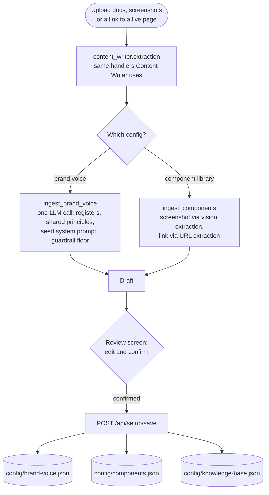

A v1 brand profile is normalized to the v2 shape on load, so older profiles keep working and no deployment inherits content it never configured.

---

## 15. LLM provider layer and budget

Every feature that calls a model goes through `llm_provider.call_structured`, so the active provider and the spend cap apply uniformly.

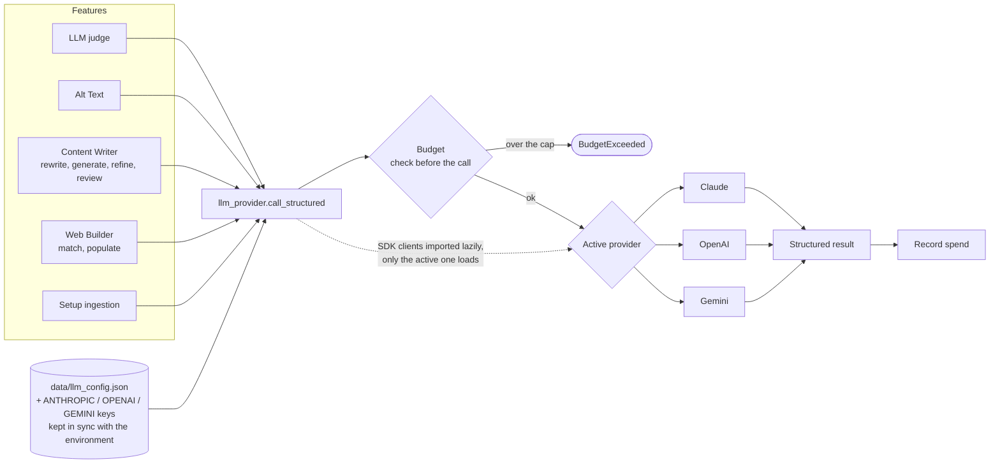

The provider is chosen in Settings. SDK exceptions are translated by `llm_cost.py` into messages a reviewer can act on. Nothing in the migration pipeline needs credentials unless `--judge` is used.

---

## 16. Local files and what is committed

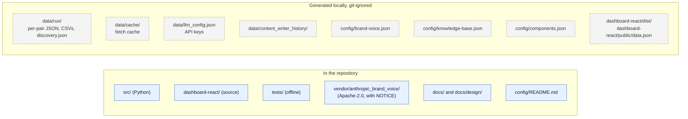

No university data, brand material or credentials ship in the repository. Crawl output, caches and the three config files are produced on your own machine, and the repository's disclaimer asks that it only be pointed at sites you are authorized to scan.
